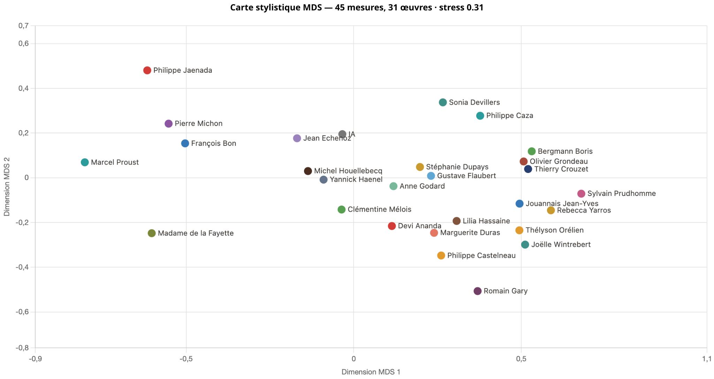
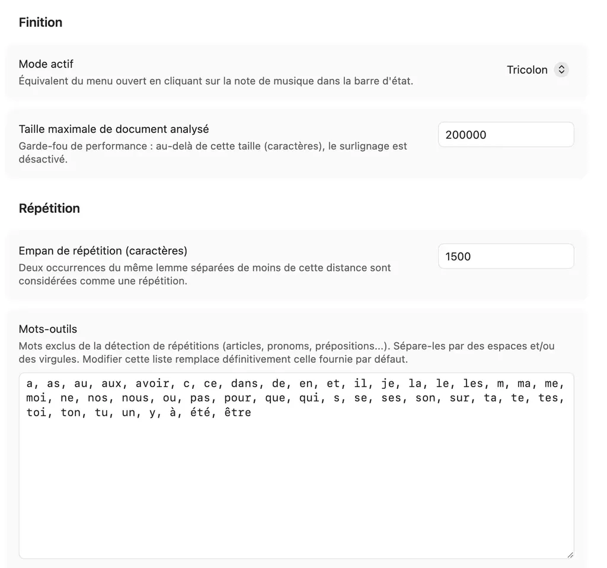
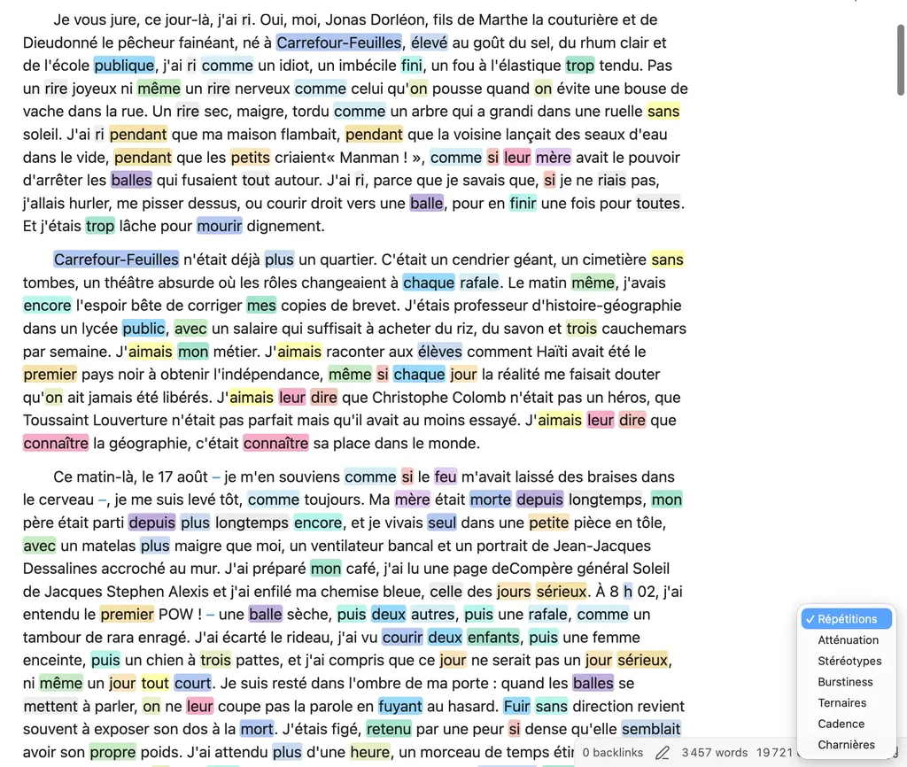
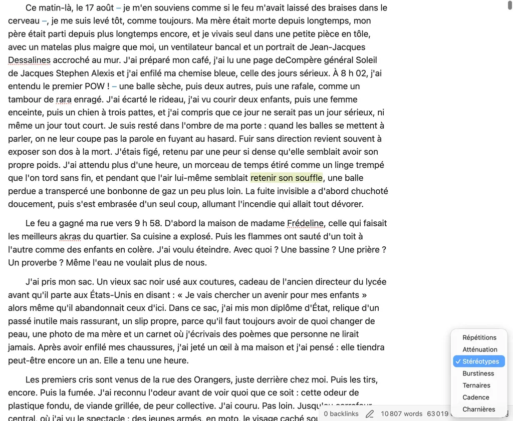
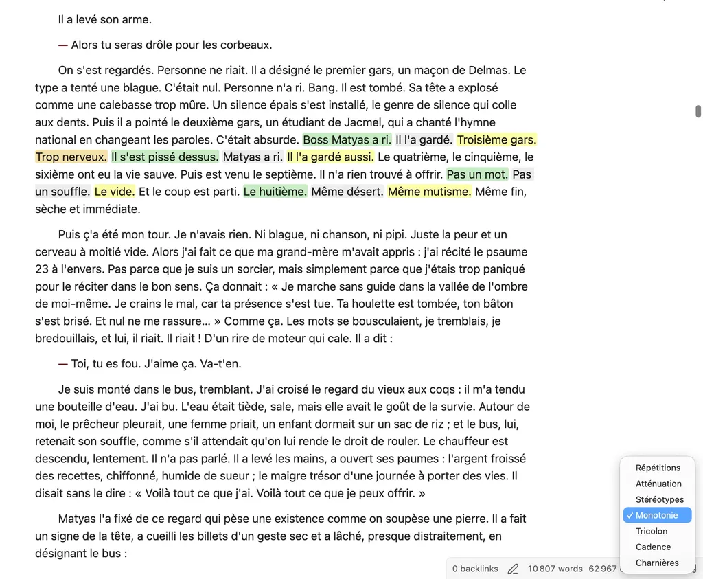
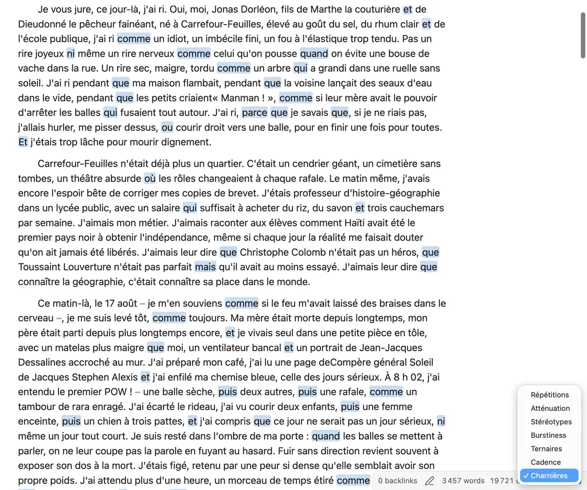
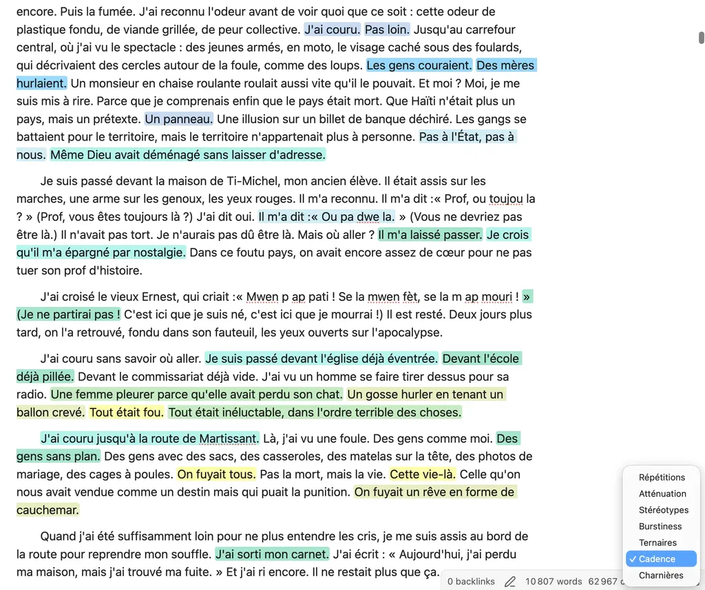

# Thélyson Orélien me pousse à réécrire Antidote

L’affaire [Thélyson Orélien](https://tcrouzet.com/2026/09/23/plagiat-IA/) a des conséquences étonnantes sur moi, au point de m’empêcher de dormir et de me mettre dans un état d’excitation presque fébrile. Elle en aura aussi de non moins stressantes pour [Druide, l’éditeur d’Antidote](https://www.druide.com/fr/).

[Après les aveux d’Orélien](https://www.lemonde.fr/critique-litteraire/article/2026/10/13/thelyson-orelien-nie-avoir-utilise-une-ia-pour-son-roman-c-etait-ca-ou-mourir_6793118_5473203.html) qui confirme ses plagiats, mais réaffirme le 100 % bio de son roman, [j’ai replongé dans les statistiques](https://tcrouzet.github.io/unshiter/), traquant les structures ternaires, les lieux communs, les monotonies syntaxiques, autant de défauts souvent attribués aux IA. Plus j’ai creusé, plus j’ai constaté que le roman d’Orélien n’était en rien extraordinaire du point de vue de la [stylométrie](https://fr.wikipedia.org/wiki/Stylom%C3%A9trie).

J’ai fini par admettre que la stylométrie ne pouvait pas nous aider à mettre en évidence la prose IA : je suis capable de générer des textes IA que je positionne où je veux sur mes graphiques. Et comme nous ne pouvons pas faire confiance à une IA pour décréter de l’humanité ou non d’un texte, nous en serons à jamais réduits à faire confiance à l’auteur, [voire à son historique de travail](https://tcrouzet.com/2026/10/04/je-suis%20humain/) – qu’Orélien semble incapable de produire [d’après son éditeur canadien](https://www.ledevoir.com/lire/1016696/editions-boreal-disent-avoir-aucune-preuve-thelyson-orelien-pas-utilise-ia) : « Nous aurions aimé pouvoir apporter des réponses définitives aux allégations qui le visent, mais, outre sa parole, nous ne disposons pas, à ce jour, d’éléments nous permettant de retracer avec précision l’historique du manuscrit avant le 12 septembre 2025, date à laquelle il a été reçu par notre équipe. »

Une autre nouvelle est venue percuter ma réflexion : [Brandon Thomas, un codeur expérimenté,](https://www.reddit.com/r/SaaS/comments/1wwnhbt/ive_created_open_source_100_rust_cleanroom/) a [vibe codé la suite Adobe](https://gizmodo.com/someone-vibe-coded-a-free-knockoff-of-adobe-creative-suite-2000823322) et [l’a distribuée en Open Source](https://getartcraft.com/). Le lien n’est pas évident, mais attendez. Depuis des années, j’utilise [Antidote](https://www.antidote.info/fr/) pour corriger mes textes et les regarder avec un œil objectif, ce qui devient vite difficile quand on écrit. J’aime Antidote, il m’est indispensable, mais parfois je le trouve limité, notamment sa détection des répétitions peu paramétrable. Alors mon cerveau s’est mis en ébullition. Pourquoi ne pas vibe coder une version du module d’analyse d’Antidote, en lui ajoutant les filtres issus de mon app statistique. Et les nuits trop courtes ont commencé.

J’aurais pu développer un outil en Rust, mais j’ai préféré créer un plugin pour [Obsidian](https://obsidian.md/), mon éditeur de texte préféré, [que je ne cesse de vous conseiller d’utiliser tant il est polyvalent et minimaliste](https://tcrouzet.com/tag/obsidian/). Si vous écrivez, peu importe quoi, Obsidian est pour vous. Oubliez Word, Ulysses et les autres outils fermés.

Mon plugin [Finition](https://github.com/tcrouzet/finition), encore à ses débuts, est déjà capable d’éclairer mes textes de façon nouvelle. Il me suffit de cliquer sur la note de musique dans la barre d’état, de choisir la fonction et le texte s’illumine.

### Répétitions

Détection par lemme (marche, marcher, marchent… sont un même lemme) sur une fenêtre glissante d’étendue réglable. La liste des mots exclus est paramétrable, tout comme la palette de couleurs des surlignages. Au début de [*L’expérience humaine*](https://tcrouzet.github.io/experience-humaine/), j’ai découvert beaucoup de répétitions involontaires non mises en évidence par Antidote. Attention : pas une raison pour devenir maniaque, mais rien de tel pour relire ses textes avec un regard neuf.

### Atténuation

Surligne les locutions de prudence rhétorique (« il semblerait que », « dans une certaine mesure »…).

### Stéréotypes

Surligne les lieux communs et clichés corporels ou émotionnels (« serrer les poings », « le cœur qui s’emballe »…).

### Monotonie

Repère les séries de phrases consécutives de longueur perceptiblement proche, signe de monotonie.

### Tricolon

Le classique : « Veni, vidi, vici. » Repère les séquences de trois groupes parallèles (« Il est grand, blond, musclé. ») dont raffolent les IA (mais les humains aussi, moi le premier – il y en avait 39 dans [*L’expérience humaine*](https://tcrouzet.github.io/experience-humaine/), j’en ai coupé la moitié grâce au plugin).

### Charnières

Surligne simplement les mots-charnières du texte (qui, que, et…) pour montrer la structure du texte et potentiellement en révéler la répétitivité.

### Cadence

Découpe chaque phrase en groupes séparés par virgule ou mot-charnière et surligne les phrases de structure identique. Si monotonie s’intéresse à la longueur des phrases, cadence cherche celles écrites un peu de la même façon dans un empan paramétrable.

La suite ? Ajouter au plugin un correcteur orthographique open source, comme [Grammalecte,](https://www.grammalecte.net/) des modules d’analyses complémentaires et même des assistants IA, notamment des modules de correction ortho-typo – que j’utilise déjà pour compléter Antidote. Je n’en suis qu’au début. Je perfectionnerai en fonction de mes besoins et des vôtres. Le plus dingue : je pourrais convertir mon plugin en Rust pour qu’il soit utilisable dans tous les outils d’écriture, mais ne le ferai pas pour vous pousser vers Obsidian, je suis pervers.

Avec le développement des IA, il deviendra de plus en plus difficile de développer des outils propriétaires et de les commercialiser. Souvent, il sera plus économique de les recoder que de les acheter. J’adore le paradoxe : la communauté du libre s’oppose souvent aux IA et les IA ouvrent un âge d’or pour le libre, rendant la notion de logiciel propriétaire obsolète.

#edition #obsidian #ia #y2026 #2026-10-16-13h00
