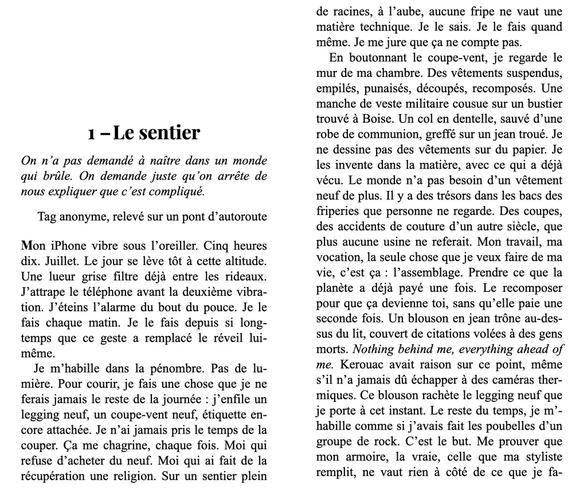
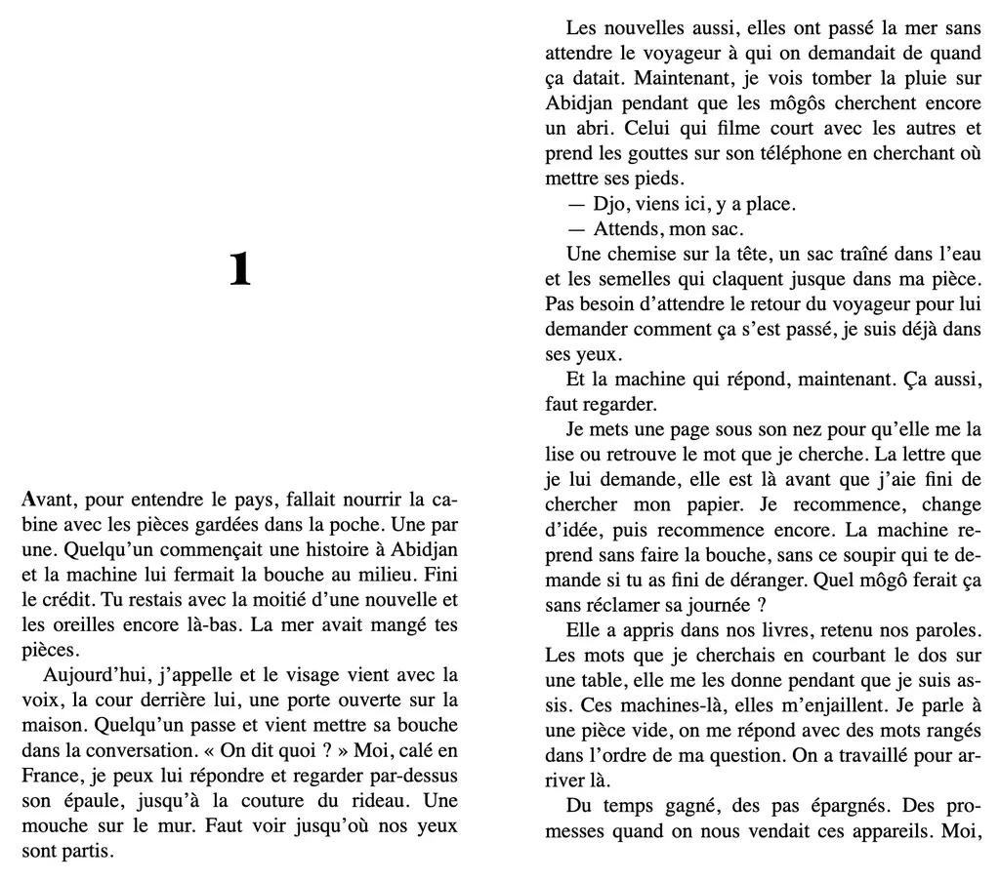
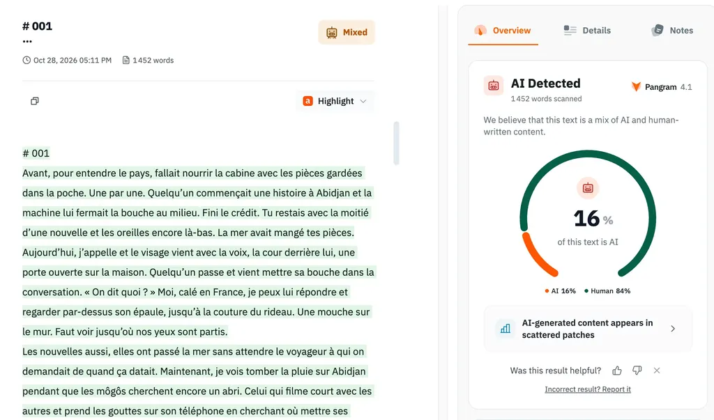

# En 2023, Olivier Nora m’écrit : « Peut-être ne sommes-nous pas prêts chez Grasset à l’écriture 2.0 »

Après [mon éloge d’Orélien](https://tcrouzet.com/2026/10/22/eloge-thelyson-orelien/), on m’a accusé d’encourager la tricherie et l’écriture IA. Il n’en est rien : je répète que j’aime écrire et que je ne déléguerais pour rien au monde mon plaisir à des machines, encore moins ma nécessité de transmettre l’expérience humaine. Il me paraît toutefois vital de comprendre ce que les IA peuvent apporter à la littérature et au travail littéraire, d’où, par exemple, mon plugin [Finition](https://community.obsidian.md/plugins/finition), un outil d’aide à la finalisation d’un manuscrit. L’irruption des IA dans nos vies devient une expérience humaine, et j’éprouve le besoin de la dire.

Dès 2023, je me suis engagé sur cette voie et j’ai documenté ma démarche. Ainsi est né [*Le Code Houellebecq*](https://tcrouzet.com/books/le-code-houellebecq/), un roman en deux parties : la première, hautement assistée par IA, je dis bien assistée, est censée avoir été écrite par Zola, une jeune autrice géniale, une IA, bien sûr ; la seconde, également assistée, mais beaucoup moins, raconte la création de la première et comment un éditeur peu scrupuleux demande à Camille, sa fille, d’endosser le rôle de Zola dans la vraie vie, tout aussi fictive, bien sûr.

Le scénario ressemble à celui de l’affaire Orélien. Les quelques éditeurs contactés à l’automne 2023 m’ont dit ne pas être prêts pour ce genre d’expérience, à commencer par Olivier Nora. Sa réponse prend désormais un sens nouveau : il a été l’éditeur d’Orélien avant de quitter Grasset (j’espère qu’il ne m’en voudra pas de rendre publique sa réponse, édifiante avec le recul).

---

Cher Thierry Crouzet,

Je suis désolé, j’avais tardé à vous répondre.

Votre texte a suscité de vives discussions parmi les éditeurs de la Maison.

D’un côté, la promesse du début est forte : Charles Moreau et sa quête, la pétaradante Camille, le choix de Houellebecq comme la figure de l’écrivain contemporain. C’est aussi évidemment amusant de constater les multiples mises en abyme, saisir les références et pastiches, et vous voir vous-même intégré à l’intrigue pour une apparition hitchcockienne.

Cela étant dit, les chapitres écrits par Zola n’ont pas convaincu : les lecteurs ont compris que le style et le caractère « froids », tels que vos personnages eux-mêmes les qualifient, correspondent à l’idée que nous nous faisons de ce que peut accomplir une IA dans le cadre de la rédaction d’une œuvre romanesque, mais les textes pèchent par la démarche… Il est difficile d’être emporté. **Ou peut-être ne sommes-nous pas prêts chez Grasset à l’écriture 2.0 ?** Il y a aussi eu le sentiment d’une chute joueuse et habile, mais beaucoup trop rapide.

Vous l’aurez compris, bien que le thème ait plu, l’enthousiasme n’est pas assez au rendez-vous pour vous proposer une publication ici.

Je suis désolé de ne pouvoir vous faire part d’un accueil plus chaleureux et vous souhaite tous les succès auprès de l’un de mes confrères plus séduit et mieux à même de garantir à ce texte la carrière que vous êtes en droit d’attendre.

Bien cordialement,

Olivier Nora

---

Nora a raison sur le plan littéraire : mon texte pèche par sa démarche. C’est une expérience dont le but n’a jamais été de distraire le lecteur, mais de stimuler son cerveau : un truc hérétique aujourd’hui. L’intérêt est ailleurs. En 2023, Nora ne se sent pas prêt pour la littérature IA, sans pour autant la rejeter. Mais trois ans plus tard, il choisit de publier chez Grasset un livre de littérature 2.0 sans en soupçonner l’origine.

L’origine d’un texte influence sa réception. C’est bien connu, [notamment depuis l’étude « A rose by any other name: A social-cognitive perspective on poets and poetry de 2012 »](https://www.cambridge.org/core/journals/judgment-and-decision-making/article/rose-by-any-other-name-a-socialcognitive-perspective-on-poets-and-poetry/646D1E15BC884D702148FDBBFB65325E). Je me doutais qu’[avouer mon emploi de l’IA dans *Le Code Houellebecq* ne pourrait qu’influencer négativement le jugement des lecteurs](https://theconversation.com/pourquoi-penser-quun-texte-a-ete-ecrit-par-une-ia-change-notre-maniere-de-le-lire-293979), mais j’étais loin d’imaginer leur [tendance à préférer la prose IA quand ils n’en sont pas informés](https://www.ledevoir.com/lire/1018025/lecteurs-preferent-ecrits-generes-ia-quand-ils-ignorent), les jurys des prix, les éditeurs et les libraires n’y échappent pas.

J’aurais pu tricher, j’y ai parfois pensé, mais j’aurais dû écrire un autre livre, surtout pas cette mise en abyme sur le rôle de l’IA en littérature, sur Romain Gary, Émile Ajar et les scandales à venir. Le sujet du *Code Houellebecq* me passionnait et les promesses des nouveaux outils me stupéfiaient. J’utilisais les premières versions publiques de ChatGPT et de Claude, sans me transformer en faussaire : je ne tentais pas de rendre Zola/Camille humaine, je voulais que transparaisse son artificialité, ce qu’a bien perçu Nora. Je voulais dire ce que ça me faisait d’écrire avec des IA, animé, une fois de plus, par le désir de partager l’expérience humaine.

J’anticipais [l’inquisition anti-IA](https://github.com/tcrouzet/orelius/blob/main/doc/exemple.md) : Camille était pourchassée sans relâche, conspuée, salie, exactement comme Orélien, alors que la France prenait des allures prérévolutionnaires sous l’effet du développement des IA. C’était presque prémonitoire.

Avec mon texte, j’espérais empêcher le déferlement de haine que nous venons de vivre, mais sa non-publication par le canal historique nous a privés de l’occasion de débattre sereinement de l’avenir de la littérature avant qu’il ne nous tombe dessus.

### Industrialisation de l’édition

Il est désormais possible de générer automatiquement un roman complet dans des environnements multiagents, comme celui de [Dust.tt](https://dust.tt/). J’ai tenté l’expérience au début de [mon étude de stylométrie](https://tcrouzet.com/2026/09/23/plagiat-IA/). Pour disposer d’[un texte IA de référence](https://tcrouzet.github.io/orelius/claude-rhizomes/), j’ai soumis à Dust une idée de scénario pour jeunes adultes, discuté de l’intrigue et défini le personnage de l’héroïne : trois heures plus tard, le roman était là, sans la moindre intervention de ma part – l’architecture multiagent mise en œuvre était des plus simplistes.

[Je viens de mettre le texte en ligne](https://tcrouzet.github.io/orelius/claude-rhizomes/) et d’en lire quelques pages pour la première fois. Ce n’est pas de la grande littérature. Il y a des incohérences, mais rien d’impossible à corriger en une journée de relecture, voire par de nouveaux agents.

Avec cette méthode quasi automatique, je n’aurais toutefois pas réussi à produire un texte capable de tromper des éditeurs prestigieux, des critiques, des jurys de prix et des libraires. Si Orélien a écrit son roman à l’aide des IA, il s’agit d’une coopération du même ordre que la mienne pour *Le Code Houellebecq*.

À l’époque, mon roman m’a demandé des mois de travail, d’essais et d’erreurs, une tâche épuisante, car la machine ne se fatigue jamais et produit des quantités faramineuses de texte à éplucher pour en tirer de rares phrases intéressantes. Je passais mon temps à corriger, à garder ce que je jugeais caractéristique de la prose artificielle, à jeter le reste, parfois à réécrire des passages entiers. J’avais la sensation d’inventer une nouvelle écriture. Je m’y engageais tout entier, avec enthousiasme. J’explorais une nouvelle voie littéraire plutôt que de tenter d’augmenter ma productivité. Je pesais chaque phrase, la faisais mienne, même si souvent elle ne me ressemblait pas. Cette non-ressemblance m’intéressait, et m’intéresse toujours.

Il est temps de refaire une expérience. Sans envie d’inventer une intrigue dans le détail ni de laisser les IA produire un plan sans queue ni tête, j’ai décidé de reprendre un roman à succès du XIXe siècle, tombé dans l’oubli, et d’en transposer la thématique à notre époque sans changer son déroulement narratif ni sa structure. En moins d’une heure de ping\-pong entre moi et elles, les IA m’ont trouvé la perle rare : *Les Deux Berceaux*, publié en 1887 par [Émile Richebourg](https://fr.wikipedia.org/wiki/%C3%89mile_Richebourg), un feuilletoniste alors populaire et presque oublié aujourd’hui, cité dans de rares articles universitaires. Clin d’œil amusant : je m’apprêtais à industrialiser une littérature déjà industrialisée à l’origine. Les IA m’ont résumé l’histoire et j’ai trouvé comment la transposer.

Pour rester dans le cas d’école Orélien, j’ai analysé son style, créé un skill d’écriture sur ce modèle, mais plutôt que d’adopter le créolisme haïtien, je suis parti du [nouchi](https://fr.wikipedia.org/wiki/Nouchi_(langue)) de Côte d’Ivoire.

Pour me simplifier la vie, je développe [Orelius](https://community.obsidian.md/plugins/orelius), un plugin Obsidian d’aide à l’écriture avec [Codex](https://openai.com/fr-FR/codex/). Encore au stade du prototype, il intègre une bible enrichie automatiquement au fil des échanges, un générateur de règles et un journal de travail. Après de nombreux ajustements techniques, j’ai réussi à produire [un premier chapitre](https://tcrouzet.github.io/orelius/codex-origines-controlees/), proche de celui d’Orélien. Son écriture, visible, expressive, à l’opposé de mon minimalisme, a de quoi saisir l’œil friand de dorures.

Bien sûr, vous pourrez contester le résultat, y trouver des défauts, d’autant que vous connaissez ma méthode et que je ne cherche pas à vous tromper. Reste que je suis bluffé. Le plus étonnant : le texte n’est détecté comme généré par IA qu’à 16 % – le même score que vient d’obtenir une amie avec son roman 100 % humain. Une preuve de l’inutilité des détecteurs. En prime, Pangram souligne les passages suspects, souvent les moins convaincants du texte. Il suffirait de les retoucher, voire de les couper, pour atteindre le 100 % humain. Cette procédure pourrait être automatisée dans mon plugin. Il pourrait apprendre à ne pas écrire de phrases suspectes. Je pourrais lui ajouter cette fonction pour aller au bout de la démonstration.

### La nécessité d’un pacte littéraire renouvelé

[Coral Hart publie vingt romans par mois et engrange des millions.](https://www.lefigaro.fr/livres/371-livres-ecrits-en-20-mois-avec-l-ia-la-methode-controversee-de-la-romanciere-sud-africaine-coral-hart-20261023) En [Afrique](https://www.bbc.com/afrique/articles/cmje572zx7jno.lite), en [Amérique du Sud](https://www.carolina.cl/noticias/2026/10/27/polemica-por-novela-premiada-detector-apunta-a-un-99-de-uso-de-ia.html), au [Japon](https://daily.steinslab.io/en/events/2026-10-23-ai-literature-awards/), ici en France, partout, des textes écrits en tout ou partie par IA se glissent dans les sélections des prix littéraires et empochent souvent la mise. Plus les IA évolueront, plus il sera difficile de distinguer les créations assistées des créations bio. Les signatures glissées dans les textes par les IA n’y changeront rien : d’autres IA, notamment des modèles locaux, les effaceront. [Quand Gallimard annonce qu’il testera ses manuscrits aux détecteurs IA](https://www.liberation.fr/culture/livres/affaire-thelyson-orelien-gallimard-va-passer-tous-ses-manuscrits-au-detecteur-dia-a-partir-de-2027-20261022_RPAKXVUKAJEETN5TM23XOJEKWA/), c’est une vaste blague.

Face à l’impossibilité technique de distinguer l’humain de l’artificiel, une seule voie subsiste : faire confiance aux auteurs. S’ils assument chaque ligne de leurs textes, ils en sont les auteurs à part entière. Peu importe leur façon de travailler, du moment qu’ils s’adressent aux lecteurs.

>Car lire, c’est peut-être aussi supposer que quelqu’un s’adresse à nous, qu’il a pensé chacun de ses mots et y a mis un peu de lui. Que cette présence devienne incertaine, et c’est toute la réception de l’œuvre qui se trouve sens dessus dessous. ([The Conversation](https://theconversation.com/pourquoi-penser-quun-texte-a-ete-ecrit-par-une-ia-change-notre-maniere-de-le-lire-293979))

Quand j’écrivais *Le Code Houellebecq*, je m’adressais aux lecteurs avec ma conviction habituelle. Ce texte est truffé de mes idées, de mes pensées, de mes doutes, même si son écriture m’est souvent étrangère, même si certaines phrases ne sont pas de moi (presque toutes ont été retouchées, toutes ont été sélectionnées dans une masse gigantesque de textes générés). C’est le fruit d’une collaboration homme-machine. Résultat : le texte apparaît 100 % humain selon Pangram.

L’important : je pouvais en parler avec passion et détailler mon processus créatif. Je pouvais discuter de mon texte en profondeur, expliquer sa genèse, mes choix stylistiques, les idées défendues, les mots choisis. Un auteur ne pourrait pas en faire autant avec un livre généré par une armée d’agents. Je n’ai rien à dire des deux textes publiés plus haut, sinon décrire le processus mis en œuvre.

Discuter avec l’auteur de son travail permet de savoir si c’est un fumiste ou un travailleur passionné. Si quelqu’un avait fait avec Orélien le boulot de [Rick Beato](https://www.youtube.com/@RickBeato) avec les musiciens, nous aurions découvert quel type d’auteur il est.

Nous n’avons d’autre recours que la confiance : un pacte entre un auteur, son éditeur et ses lecteurs. La crise actuelle ne serait pas si vive si ce pacte n’avait pas été miné depuis longtemps par la marchandisation de la littérature. Peut-être qu’ici, en ligne, avec mes abonnées, se noue un pacte de fer. Vous savez ce que j’ai dans la tête, je vous parle de mon travail, nous avançons ensemble.

#edition #ia #y2026 #2026-10-20-11h00
