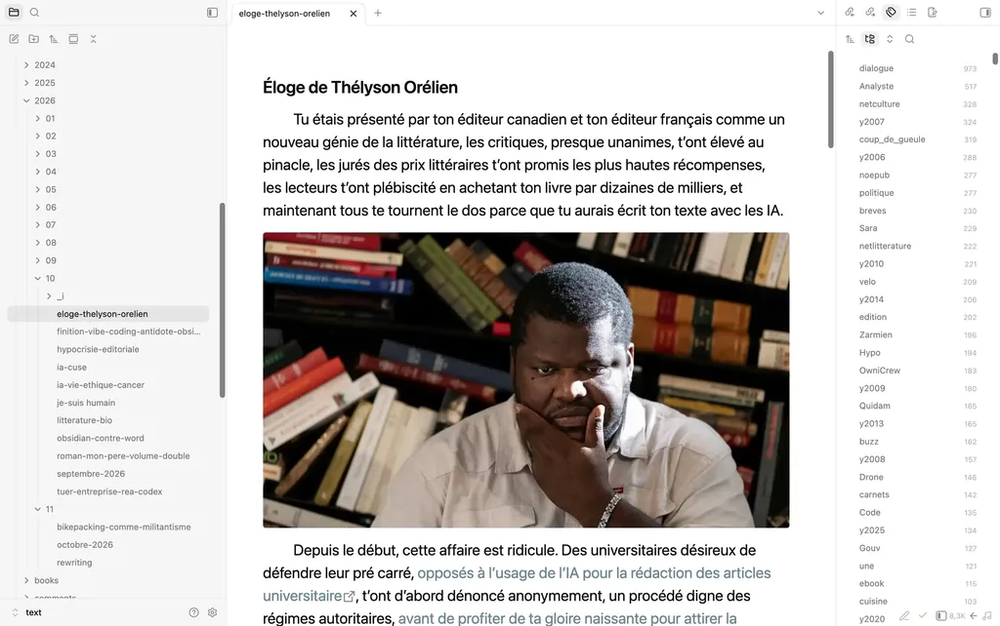
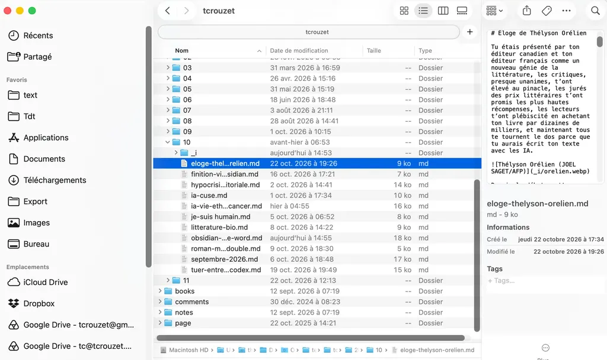
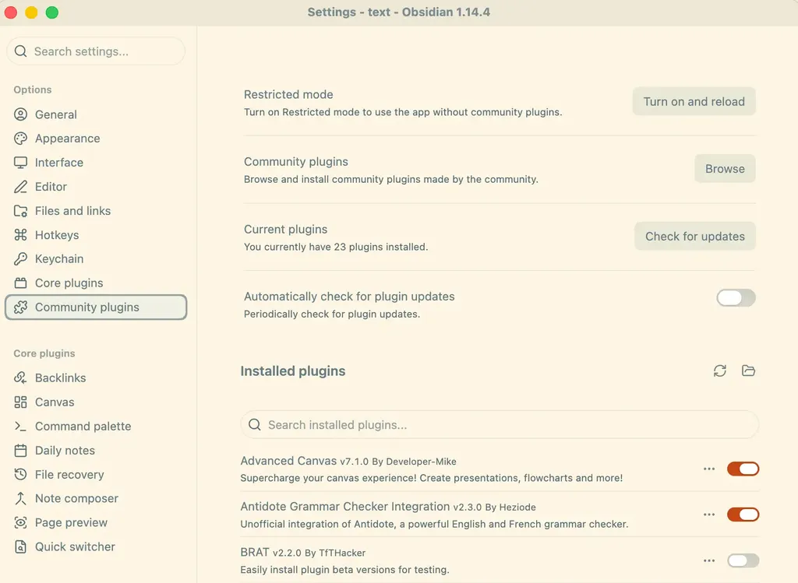
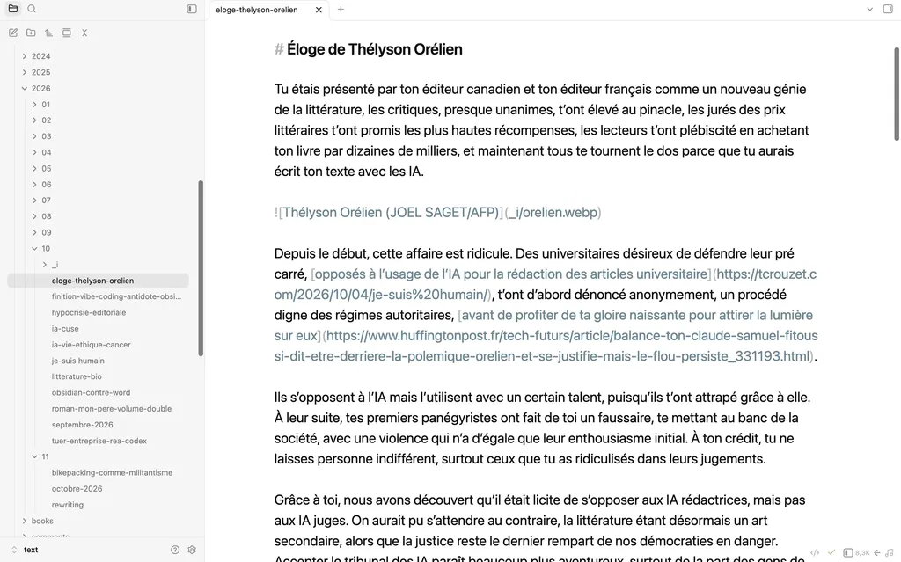
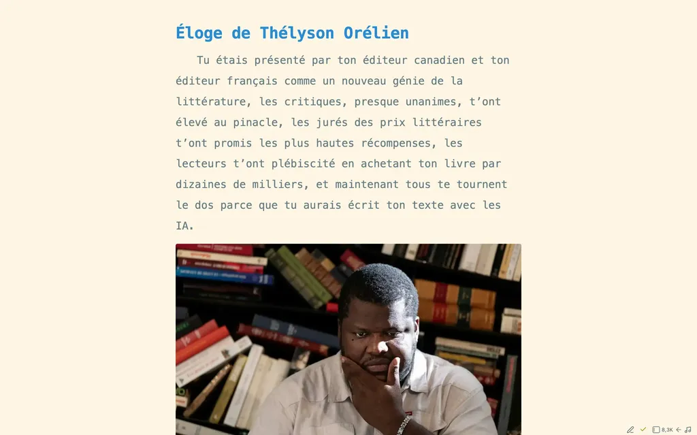
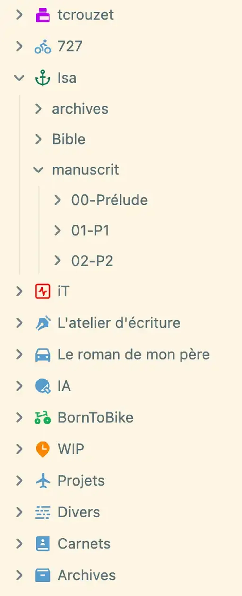
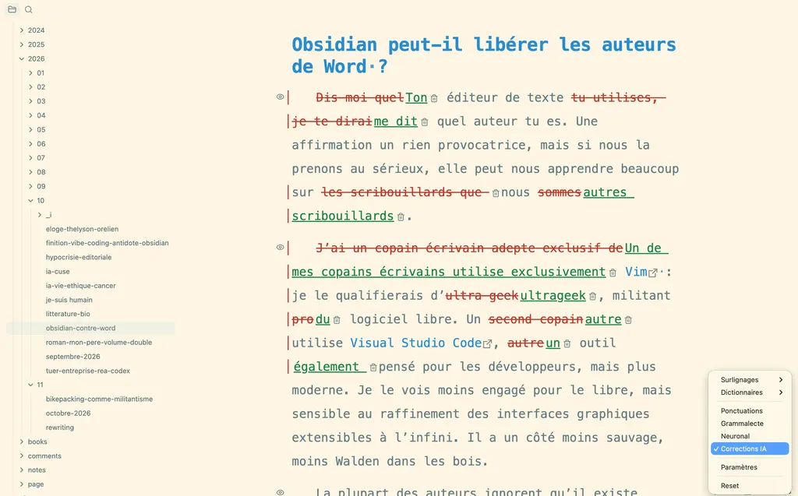

# Obsidian peut-il libérer les auteurs de Word ?

Dis-moi quel éditeur de texte tu utilises, je te dirai quel auteur tu es. Une affirmation un rien provocatrice, mais si nous la prenons au sérieux, elle peut nous apprendre beaucoup sur les scribouillards.

Un de mes copains écrivains utilise exclusivement [Vim](https://www.vim.org/) : je le qualifierais d’ultrageek, militant pro logiciel libre. Un autre utilise [Visual Studio Code](https://code.visualstudio.com/), un outil également pensé pour les développeurs, mais plus moderne. Je le vois moins engagé pour le libre, mais sensible au raffinement des interfaces graphiques extensibles à l’infini. Il a un côté moins sauvage, moins Walden dans les bois.

La plupart des auteurs ignorent qu’il existe autant d’outils d’écriture numérique que de types de stylos, de pinceaux ou d’instruments de musique. La vraie question : pourquoi presque tout le monde utilise Word ? C’est un peu comme si tous les musiciens étaient pianistes, si tous les compositeurs se limitaient au piano ou si tous les peintres n’utilisaient que des petits-gris. La création musicale et picturale en serait appauvrie. Word n’est pas un passage obligé. Il s’inscrit dans une histoire des outils d’écriture vieille d’une soixantaine d’années, si on s’en tient à leur dimension numérique.

### Chronologie des éditeurs de texte

- **1964** [TYPSET/RUNOFF](https://en.wikipedia.org/wiki/TYPSET_and_RUNOFF) est le premier système de mise en forme de texte par balisage : on saisit des commandes dans le texte, puis un programme produit la mise en page. [IBM MT/ST](https://en.wikipedia.org/wiki/IBM_MT/ST) est une machine à écrire qui enregistre le texte sur bande magnétique et permet de le modifier. Invention du terme « word processing ».
- **1965** [TVEDIT](https://gunkies.org/wiki/TVEDIT) est le premier éditeur de texte plein écran, utilisé par les programmeurs de Stanford. Les fichiers texte apparaissent en même temps : ils contiennent uniquement le texte saisi, sans métadonnées, avec un simple encodage des caractères en [ASCII](https://en.wikipedia.org/wiki/ASCII). C’est le format le plus simple possible.
- **1968** [*Bomber*](https://en.wikipedia.org/wiki/Bomber_(novel)) de Len Deighton, publié en 1970, est le premier roman écrit sur un traitement de texte (IBM MT/ST).
- **1974** Apparition des extensions de fichier, notamment de l’extension [.TXT](https://en.wikipedia.org/wiki/CP/M). [Bravo](https://en.wikipedia.org/wiki/Bravo_(software)) est le premier éditeur [WYSIWYG](https://en.wikipedia.org/wiki/WYSIWYG) : la mise en page à l’écran correspond au résultat imprimé.
- **1976** [Emacs](https://fr.wikipedia.org/wiki/Emacs) est un éditeur extensible par scripts : on peut le reprogrammer soi-même et le spécialiser. [Electric Pencil](https://en.wikipedia.org/wiki/Electric_Pencil) devient le premier traitement de texte pour micro-ordinateur.
- **1977** Avec [vi](https://fr.wikipedia.org/wiki/Vim_\(logiciel\)) apparaît l’édition modale : un mode pour naviguer et lancer des commandes, un autre pour insérer du texte.
- **1978** [WordStar](https://fr.wikipedia.org/wiki/WordStar), accessible aux non-informaticiens, offre la mise en page à l’écran. Apparition de [TeX](https://fr.wikipedia.org/wiki/TeX), langage de description de page, avec des balises à insérer dans le texte.
- **1979** [WordPerfect](https://fr.wikipedia.org/wiki/WordPerfect) devient le traitement de texte de référence.
- **1983** [Microsoft Word](https://fr.wikipedia.org/wiki/Microsoft_Word) généralise l’usage de la souris et des menus pour la mise en forme.
- **1984** Apparition de [LaTeX](https://fr.wikipedia.org/wiki/LaTeX), une extension de TeX.
- **1991** [Vim](https://fr.wikipedia.org/wiki/Vim_(logiciel)), évolution de vi, ajoute des fenêtres multiples, la coloration syntaxique et les scripts. Il reste l’éditeur modal de référence.
- **1992** L’ASCII encode 128 caractères ; [UTF-8](https://www.trichromic.co.uk/news/from-ascii-to-utf-8-why-character-encoding-still-matters/) permet désormais d’encoder tous les caractères de toutes les langues.
- **2003** [Ulysses](https://fr.wikipedia.org/wiki/Ulysses_(logiciel)) organise l’écriture en bibliothèque de textes indépendants de leur mise en forme. Il est conçu pour les projets longs plutôt que pour un document unique. Il s’adresse aux écrivains, essayistes et universitaires.
- **2004** [Markdown](https://fr.wikipedia.org/wiki/Markdown) : langage de mise en forme ultraléger, lisible tel quel, sans logiciel dédié ni commandes complexes de type LaTeX.
- **2006** [Google Docs](https://fr.wikipedia.org/wiki/Google_Docs,_Sheets,_Slides_et_Forms) : clone de Word dans le navigateur, avec édition collaborative en temps réel.
- **2007** Sur le modèle d’Ulysses, [Scrivener](https://fr.wikipedia.org/wiki/Scrivener_(logiciel)) organise les textes longs en scènes ou en fiches déplaçables plutôt qu’en un seul fichier linéaire. Son tableau de liège fait sa popularité.
- **2010** [iA Writer](https://en.wikipedia.org/wiki/IA_Writer) reprend la philosophie d’Ulysses et introduit un minimalisme radical avec Markdown. Son mode focus isole la phrase en cours.
- **2013** [Ulysses](https://ulysses.app/) passe à Markdown, mais conserve un gestionnaire de fichiers opaque par rapport à celui d’iA Writer.
- **2016** [Visual Studio Code](https://code.visualstudio.com/) est un éditeur de texte destiné à la programmation, ouvert à d’innombrables extensions. Certaines permettent d’écrire en plein écran, sans distraction et en Markdown, comme dans iA Writer et Ulysses.
- **2019** [Roam Research](https://roamresearch.com/) propose des liens bidirectionnels entre notes et une visualisation en graphe : la note n’est plus un document isolé, mais un nœud relié à d’autres.
- **2022** [Obsidian 1.0](https://obsidian.md/) reprend le graphe de Roam, mais s’appuie sur des fichiers Markdown stockés localement, sans dépendre d’un service en ligne. Il adopte aussi l’interface et la philosophie d’Ulysses et d’iA Writer. Bien que propriétaire, il offre une API et suscite un vaste écosystème d’extensions. Il existe des plugins pour tout, même pour l’écriture assistée par IA.

Cette histoire me passionne. Après 1983, il ne se passe rien du côté des traitements de texte pendant vingt ans : Word s’impose comme l’outil d’écriture universel, à tel point que, pour beaucoup, la messe est dite. Il faut attendre Ulysses, Scrivener et iA Writer, apparus entre 2003 et 2010 pour que les outils évoluent à nouveau.

Word est un outil à tout faire, sans exceller nulle part. Les nouveaux logiciels s’adressent aux auteurs de textes longs. Ils offrent des interfaces minimalistes, sans distraction, et adoptent le Markdown pour accélérer la saisie, éviter le recours à la souris, standardiser le formatage, séparer le texte de sa mise en forme. Ces éditeurs de texte facilitent la navigation entre de nombreux fichiers, la recherche, la gestion de la documentation, la publication sur le web, l’exportation en PDF et ePub. Ils font gagner beaucoup de temps, fluidifient le travail, favorisent l’immersion dans les textes.

Mais la plupart des auteurs restent englués dans Word. Soit ils ignorent tout des nouveaux outils, soit ils craignent de changer de crémerie. Une certitude : après la transition, le retour en arrière est impensable, tout comme pour un artisan repassé au marteau-burin après avoir découvert le burineur.

Pour le code, j’ai utilisé vi, puis Vim. Je les utilise toujours sous Linux, mais leur préfère Visual Studio Code sur Mac. Pour l’écriture, je suis passé de WordPerfect à Word, puis à Scrivener et Ulysses. J’ai testé tous les autres outils au passage, avant d’adopter [Obsidian](https://obsidian.md/) fin 2023, soit un peu plus d’un an après sa première version stable – [j’ai tardé parce qu’Ulysses m’emprisonnait](https://tcrouzet.com/2023/12/25/pris-en-otage-par-ulysses-app/). Je vous encourage à franchir le Rubicon. C’est gratuit. Vous en serez récompensé.

### Obsidian

[Obsidian](https://obsidian.md/) est un éditeur de texte Markdown. Vos fichiers ne contiennent rien d’autre que ce que vous voyez à l’écran. [Pas de risque que des agents étrangers y cachent des métadonnées invisibles.](https://tcrouzet.com/2026/10/22/eloge-thelyson-orelien/) Vous pouvez ouvrir les fichiers avec Visual Studio Code, Vim, iA Writer, n’importe quel éditeur de texte, sur Mac, Windows, Linux, iOS, Android. S’enfermer dans un format de fichier plus complexe n’a plus de sens. Markdown pérennise vos textes numériques et offre une interopérabilité maximale. Vous pouvez utiliser plusieurs stylos numériques, en changer entre votre ordinateur et votre téléphone.

Avec sa colonne de gauche, Obsidian est un explorateur de fichiers. Vous naviguez dans les dossiers et sous-dossiers comme dans votre système. Au départ, il vous demande de choisir ou de créer un dossier de référence, le coffre, point de départ de la navigation.

Le coffre n’est que le dossier où seront rangés vos textes. Je manipule souvent le mien avec le Finder de macOS, plus pratique pour copier et réorganiser les fichiers. Obsidian n’ajoute pas de base de données maison. C’est essentiel pour garantir l’interopérabilité avec d’autres applications et la pérennité de l’architecture de vos données. Pour une sauvegarde, une copie de tout ou partie du coffre sur un disque externe suffit. Toute modification de l’organisation du coffre par une autre application se répercute aussitôt dans Obsidian, que vous pouvez considérer comme un navigateur dans vos fichiers texte.

À un coffre, on associe des préférences, un thème, des plugins. On peut créer un coffre par projet. Pour ma part, je conserve un seul coffre avec tous mes projets dans des sous-dossiers, ce qui m’évite de tout reconfigurer chaque fois.

Si vous arrivez de Word, la première étape est d’installer le plugin [Docxer](https://community.obsidian.md/plugins/docxer) (les plugins communautaires s’installent depuis le menu Préférences). Une fois Docxer installé et activé, vous pourrez convertir un Docx, en le déposant dans un des dossiers du coffre, puis en l’ouvrant. Vous pourrez toujours revenir à Docx avec [toWord](https://community.obsidian.md/plugins/to-word).

Apprendre le Markdown prend un rien de temps. [Les balises sont peu nombreuses, intuitives, on n’y pense rapidement plus](https://fr.wikipedia.org/wiki/Markdown). Grand avantage du Markdown, on produit un texte propre : pas de sauts de ligne multiples, de tabulations, d’enrichissements typographiques. Vous disposez du strict nécessaire. Par défaut, Obsidian met en forme le texte à l’écran et masque les balises Markdown.

Obsidian est un châssis-moteur à habiller de multiples carrosseries (les thèmes) et à équiper de divers accessoires (les plugins). Voici ma configuration de travail.

### Mon thème

Dans Ulysses, j’aimais l’interface dépouillée. J’ai donc créé [Ultra Minimal](https://community.obsidian.md/account/themes/ultra-minimal), un thème pour retrouver les mêmes conditions de travail. Je règle la taille de police par défaut à 23 px et conserve une colonne de texte assez étroite. J’ai adapté [les couleurs solarisées](https://ethanschoonover.com/solarized/) tout en maximisant le contraste du texte su l’arrière-plan. J’ai choisi Menlo, la police par défaut d’Ulysses. L’idée est d’avoir un texte qui plaît à mes yeux.

Le rendu du texte à l’écran est indépendant de celui du texte publié, une distinction à laquelle Word ne nous a pas habitués. Écrire avec Obsidian nous rapproche de la machine à écrire. Le but est de produire du texte et rien d’autre. Sans distraction, sans déviation, sans enrichissement.

Mon thème cache la plupart des barres d’outils et des fenêtres de navigation d’Obsidian pour ne garder que l’essentiel à l’écriture. Au départ, j’utilisais deux plugins pour atteindre cette simplification extrême, [Hider](https://community.obsidian.md/plugins/obsidian-hider) et [ProZen](https://community.obsidian.md/plugins/obsidian-prozen), avant de découvrir que quelques lignes dans mon thème suffisaient à produire le même effet, avec moins de code et de complications.

### Mes plugins

#### Interface

[**Iconize**](https://community.obsidian.md/plugins/obsidian-icon-folder) Ajoute des icônes aux fichiers et aux dossiers. M’aide à naviguer plus vite dans mon arborescence.

[**macOS Keyboard Navigation**](https://community.obsidian.md/plugins/macOS-keyboard-nav-obsidian) Rétablit la navigation au clavier : ⌥↑ ou ⌥↓ pour aller au début ou à la fin du paragraphe, ⌥⇧↑ ou ⌥⇧↓ pour sélectionner jusqu’au début ou à la fin du paragraphe.

[**Remember cursor position**](https://community.obsidian.md/plugins/remember-cursor-position) Mémorise la position du curseur et du défilement pour chaque note. Quand je reviens dans une note, je retrouve ma position exacte, même des semaines plus tard.

[**Status Bar Organizer**](https://community.obsidian.md/plugins/statusbar-organizer) Permet de réorganiser et de masquer certains éléments de la barre d’état.

[**Custom File Explorer sorting**](https://community.obsidian.md/plugins/custom-sort) Par défaut, Obsidian trie les fichiers comme un gestionnaire de fichiers, par ordre alphanumérique ou chronologique. Ce plugin permet de tricher. Je l’utilise notamment au sommet de mon arborescence, mais jamais dans mes dossiers de travail. Je veux que mes fichiers conservent l’ordre alphanumérique naturel géré par le système.

#### Rédaction

[**French Typos**](https://community.obsidian.md/plugins/french-typos) J’ai développé ce plugin dès mon arrivée sur Obsidian. Je ne supportais pas les apostrophes et les guillemets droits, les espaces insécables invisibles, les tirets cadratins ou demi-cadratins difficiles à saisir.

[**Linter**](https://community.obsidian.md/plugins/obsidian-linter) Formate les notes dans le respect de la syntaxe Markdown, par exemple en ajoutant un second saut de ligne en fin de paragraphe. Indispensable pour avoir un fichier propre.

[**Finition**](https://community.obsidian.md/plugins/finition) Je viens de développer ce plugin pour fignoler mes textes sans quitter Obsidian. Il traque les répétitions, les stéréotypes, les fautes d’orthographe et de grammaire avec un correcteur neuronal ou une IA (via OpenAI, Anthropic ou un modèle installé en local). Jusqu’ici, je quittais l’application pour ces corrections. Je gagne désormais un temps fou. Je suis époustouflé par tous les services que j’ai réussi à intégrer à Finition.

[**Antidote Grammar Checker Integration**](https://community.obsidian.md/plugins/antidote-grammar-checker-integration) Intégration non officielle d’Antidote. Je continue de l’utiliser en parallèle de Finition.

### Sauvegarde

[**Git**](https://community.obsidian.md/plugins/obsidian-git) Sauvegarde en temps réel mon coffre dans un dépôt privé sur GitHub. [Je n’ai plus peur de perdre quelque chose, et en prime possibilité de remonter dans l’historique.](https://tcrouzet.com/2026/10/04/je-suis%20humain/)

### Exportation

[**Folder Fusion**](https://community.obsidian.md/plugins/folder-fusion) Un autre de mes plugins maison. Je structure mes bouquins avec une note par chapitre, un dossier par partie. Avec ce plugin, je compile toute la hiérarchie en un seul fichier exportable. Je peux renuméroter les fichiers avec un préfixe pour indiquer leur place dans le livre. Il existe des plugins dédiés à l’écriture de livres, mais je les trouve beaucoup plus complexes. Le plus souvent, ils utilisent une base de données, ce que je proscris.

**[Bookbinder](https://community.obsidian.md/plugins/bookbinder)** Par défaut, Obsidian propose l’exportation en PDF. Je vous ai parlé de l’exportation en Docx. Pour aller plus loin, contrôler les détails et produire des ePub, PDF et Docx de qualité professionnelle, je développe ce plugin. Il intègre mon expérience de la mise en forme, acquise en près de quarante ans. J’y ai transposé mes scripts Python de pilotage de [Pandoc](https://pandoc.org/) et [Latex](https://www.latex-project.org/). Le plugin d’exportation le plus populaire, [Enhancing Export](https://community.obsidian.md/plugins/obsidian-enhancing-export), ne m’a jamais convaincu. Désormais, depuis le menu contextuel d’un dossier ou d’un fichier, je peux lancer la conversion et obtenir une mise en page impeccable, réglable dans les moindres détails depuis Obsidian. Bookbinder intègre la plupart des fonctionnalités de Folder Fusion, sauf la numérotation. J’ajuste le code au fil de mes besoins.

Je vous ai expliqué pourquoi le passage à Obsidian valait le coup et vous ai décrit ma configuration de travail. [Il existe beaucoup de tutoriels sur YouTube](https://www.youtube.com/results?search_query=obsidian+tutorial). Si vous basculez sur Obsidian, vous vous demanderez dans quelques jours pourquoi vous avez attendu aussi longtemps.

Je n’utilise plus Word que pour écrire des lettres destinées à l’administration. Il m’est aussi utile quand on me renvoie un texte en mode révision. Si les éditeurs travaillaient en Markdown, il serait pourtant plus simple de comparer leurs fichiers aux miens. Je garde les yeux ouverts. Le successeur d’Obsidian est peut-être déjà en gestation. Nous n’avons aucune raison de penser que nos outils d’écriture ont cessé de progresser.

#netlitterature #obsidian #y2026 #2026-10-27-19h00
