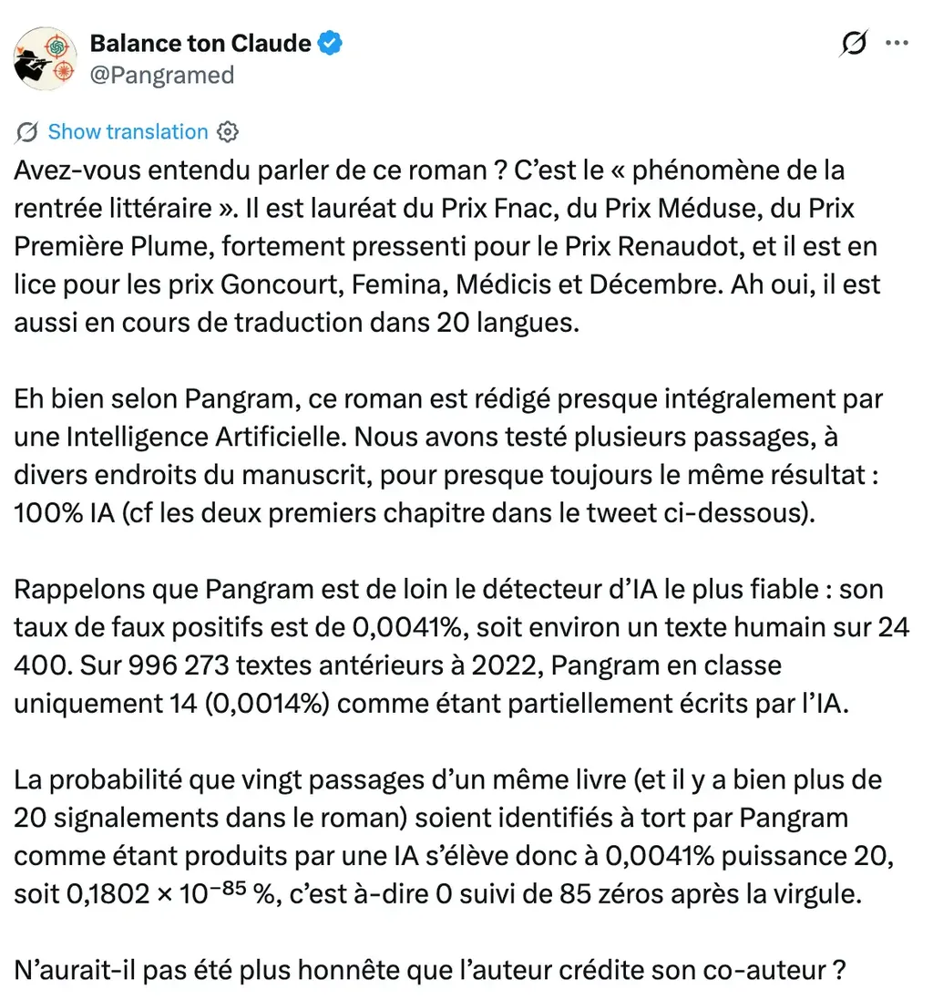
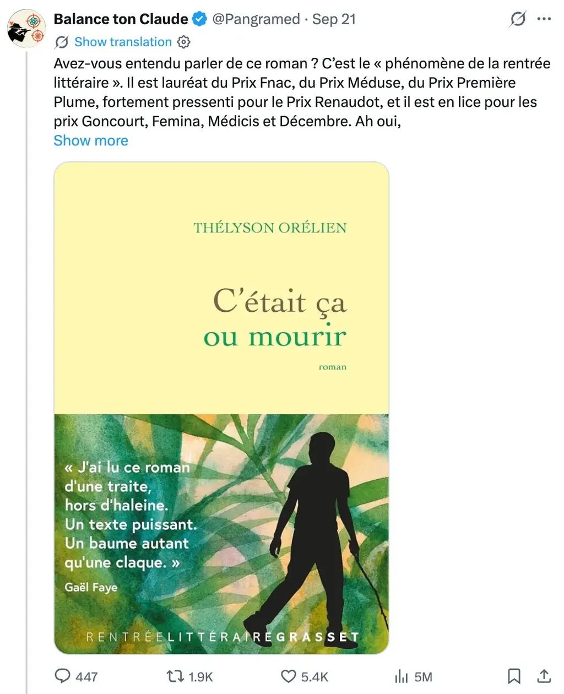

# L’affaire Orélien révèle-t-elle une crise de la critique littéraire ?

Qui a dit quoi ? Qui a maintenu sa position, qui a changé d’avis, qui s’est renié, qui s’est retourné contre Thélyson Orélien ? L’affaire nous parle du travail de la critique, de notre façon de lire, de comment des informations extérieures nous influencent ou pas. Elle nous impose de nous questionner sur la nature de la littérature quand des machines peuvent en produire.

## Archéologie d’un succès annoncé

### 12 septembre 2025

[Les Éditions du Boréal reçoivent le manuscrit de *C’était ça ou mourir*.](https://www.lapresse.ca/arts/litterature/2026-10-14/utilisation-alleguee-de-l-ia/l-editeur-de-c-etait-ca-ou-mourir-dit-avoir-recu-le-manuscrit-seulement-l-an-dernier.php) Selon Renaud Roussel, patron de Boréal, [le texte a fait l’objet d’environ cinq mois de travail éditorial, qui ne termine que fin janvier.](https://www.ledevoir.com/lire/1016888/c-etait-ou-mourir-restera-librairie)

### 6 février 2026

Sur ses comptes sociaux, Boréal annonce la parution le 9 mars de *C’était ça ou mourir*. [Le communiqué](https://www.instagram.com/p/DUbJA66laQp/) résume la scénographie du roman.

>« Quand mon quartier a brûlé, j’ai ri comme un idiot. » Devant l’horreur, plutôt que de pleurer, Jonas Dorléon choisit de rire. Rire et marcher.

Suit un incipit du roman. « Prof d’histoire et de géographie à Carrefour-Feuilles, un quartier densément peuplé de Port-au-Prince, Jonas est contraint de quitter sa maison. Dans les rues, des coups de feu, des flammes le somment de partir sans regarder derrière. Il n’emporte presque rien : son diplôme, un cahier de poèmes, une photo de sa mère et un slip propre. Sa vie entière dans un sac de plastique. »

Ce communiqué donne la couleur sans survendre. Simple et efficace.

En parallèle, [Boréal met aux enchères les droits de publication, de traduction et de cession territoriaux.](https://www.lefigaro.fr/livres/c-etait-ca-ou-mourir-rencontre-avec-thelyson-orelien-cet-ecrivain-totalement-inconnu-dont-le-premier-roman-est-un-phenomene-mondial-20260821) Grasset empoche la licence pour l’Europe francophone, [dix-huit autres éditeurs acquièrent les droits pour leurs pays et langues respectives](https://www.editionsboreal.qc.ca/fr/livres/collection-generale/9782764629253-c-etait-ca-ou-mourir.html).

* Pays-Bas (De Bezige Bij)
* Canada anglais (Doubleday)
* Brésil (Intrínseca)
* Espagne + Amérique latine (castillane) : Salamandra
* Catalan (Bromera)
* Allemagne (Rowohlt)
* Italie (Rizzoli)
* Finlande (WSOY)
* Pologne (Karakter)
* UK + Commonwealth (Summit)
* Hongrie (Sarkozy)
* Turquie (Domingo)
* US (Scribner)
* Portugal (Dom Quixote)
* Israël (Modan)
* Suède (Natur och Kultur)
* Lituanie (Alma Littera)
* Serbie (Prometej)

L’emballement commence là, comme pour tous les best-sellers dont la vente aux enchères des droits précède leur succès, ce qui interdit par la même occasion leur échec. Tout est fait pour les pousser en avant. On est dans la spirale promotionnelle dont ne bénéficient que très peu de titres. Le succès d’Orélien est orchestré. Les journalistes tombent tout de suite dans le piège : attirés par ce qui brille. Les éditeurs ont signé un pacte.

### 4 mars 2026

Anne-Frédérique Hébert-Dolbec publie dans [*Le Devoir* un premier article](https://www.ledevoir.com/lire/961050/c-etait-ou-mourir-thelyson-orelien-ecrit-langue-exil) alors que le roman n’est pas encore en librairie. Collection de superlatifs :

* Un « exceptionnel premier roman ».
* Un « récit poétique et profondément lucide ».
* Une langue « précise et imagée, rigoureuse, mais à fleur de peau ».
* Le texte va donner « un nom et des mots » à l’expérience de l’exil, habituellement réduite à des chiffres et à des statistiques.

Cet article parle des contrats étrangers signés par Boréal, un fait mentionné parce qu’il a déjà coloré la lecture de la journaliste. Comment aurait-elle pu critiquer le livre ou ne serait-ce que le trouver plat ? Les plus grands éditeurs adorent, impossible de les déjuger sans paraître ridicule. Le rouleau compresseur éditorial est en marche.

### 9 mars 2026

Parution du livre chez Boréal avec [une note rétrospectivement amusante](https://www.editionsboreal.qc.ca/fr/livres/collection-generale/9782764629253-c-etait-ca-ou-mourir.html) : « La plume foisonnante et poétique de Thélyson Orélien fait jaillir la beauté dans les zones les plus sombres de l’expérience humaine. Il parle la langue de l’exil, cette langue qui s’apprend “sans grammaire, sans dictionnaire, juste avec les os et la peau”. Surtout, il révèle une Amérique terrible et violente sur laquelle notre regard doit s’attarder. »

Plus qu’un énième récit, le roman serait une expérience physique de la langue, capable de transformer la souffrance en beauté et de rendre aux migrants un visage individuel.

### 12 mars 2026

[Sur Radio-Canada](https://ici.radio-canada.ca/ohdio/premiere/emissions/il-restera-toujours-culture/segments/rattrapage/2321684/thelyson-orelien-son-premier-roman-c-etait-ca-ou-mourir-boreal), la journaliste présente le livre comme suscitant « un grand intérêt du lectorat à l’international », ce qui est faux, puisque le livre n’est sorti nulle part ailleurs, on reste dans le pur marketing. La journaliste dit que plusieurs phrases lui ont coupé le souffle. Elle cite deux exemples : « La paix n’existe pas. Ce n’est que la peur qui change de vêtements. » ([épanorthose](https://fr.wikipedia.org/wiki/%C3%89panorthose)) et « C’est le genre de gars qui parle plus qu’il ne pense, mais qui pense plus qu’il n’ose le dire. » ([antithèse](https://fr.wikipedia.org/wiki/Antith%C3%A8se), dire deux choses contraires, ce qui revient à ne rien dire). Deux trucs dont les IA sont friandes (ce qui ne prouve rien quant à la nature IA du texte, bien sûr, mais c’est amusant de le noter). Orélien déclare : « Aucun destin humain ne mérite d’être résumé par un cliché. »

La réception commence donc par une opération de cadrage. Le livre est lu comme une réponse à la déshumanisation des migrants avant d’être discuté dans ses détails formels. Le lecteur est invité à attendre du roman une vérité humaine, une dignité et une correction du regard porté sur l’exil. Orélien est très vague sur le travail littéraire et le temps passé sur le projet, comme quand on lui demande combien de migrants il a interrogés.

### 18 mars 2026

[Entretien vidéo diffusée par Radio-Canada](https://ici.radio-canada.ca/videos/1-10621436/c-etait-ca-ou-mourir-entrevue-avec-auteur-thelyson-orelien), le livre présenté comme « le vibrant récit d’un périple d’Haïti à Montréal ».

[Sur 98.5](https://www.985fm.ca/audio/763945/c-etait-ca-ou-mourir-le-parcours-poignant-d-un-exile), Catherine Brisson parle à son tour d’un « engouement international exceptionnel avant même sa parution », ce qui est contradictoire. Elle aurait dû dire : « Les éditeurs étrangers se disputent Orélien alors que rien ne prouve que le livre aura du succès. » Elle ajoute : « Aussi bon qu’on le dit, mais encore plus… Exceptionnel… Ça va droit au cœur ! »

### 28 mars 2026

[Dans le *Journal de Montréal*](https://www.journaldemontreal.com/2026/03/28/un-engouement-international-pour-le-bouleversant-premier-roman-portant-sur-limmigration-de-thelyson-orelien-cetait-ca-ou-mourir), Sarah-Émilie Nault publie « Un engouement international pour le bouleversant premier roman portant sur l’immigration de Thélyson Orélien ». Aucun chiffre de vente n’a encore été communiqué par Boréal. C’est de l’enfumage.

### 8 avril 2026

Sur Radio-Canada, Patricia Tadros annonce que [Thélyson Orélien signe un succès jamais vu aux Éditions du Boréal](https://ici.radio-canada.ca/arts/livres/accueil-actualites/document/nouvelles/article/2241951/thelyson-orelien-roman-boreal-succes-litteraire). Renaud Roussel explique que l’intérêt est lié à la proximité du livre avec l’actualité migratoire, mais surtout à son style : « Dès les premières phrases, on sait qu’on est face à une voix unique, véritablement originale. »

Il ajoute :

« Je pense que la grande force du livre, c’est son style et c’est ce talent qu’a Thélyson Orélien pour nous faire voir cette crise des migrants de l’intérieur. »

### 27 juin 2026

Sur Babelio, [CristianoBobino](https://www.babelio.com/livres/Orelien-Cetait-ca-ou-mourir/2009307/critiques/5243763) publie une critique prophétique : « Tout ça pour ça…! Ce roman-phénomène à “l’engouement exceptionnel dans le monde”, un des titres déjà mis en avant pour la rentrée littéraire française de septembre, avec ici des éloges appuyés (venant en partie de certains comptes qui semblent créés pour l’occasion…) , m’a laissé de marbre du début à la fin. C’est convenu, sans surprise, parfois gros sabots, parfois cul cul la praline. Les fins de chapitres me donnent l’impression de mauvais posts Linkedin écrits avec ChatGPT. Je n’ai ressenti aucune émotion alors que cela se veut manifestement émouvant. Après, si cela peut ouvrir des yeux sur la condition des migrants, sur l’inhumanité des politiques trumpistes ou simplement de droite (y compris celles en France), ce sera toujours ça de pris. Pour ma part je l’aurais vite oublié. »

## Le débarquement en France

### 30 juillet 2026

[*Livres Hebdo*](https://www.livreshebdo.fr/article/thelyson-orelien-remporte-le-prix-meduse-2026) décrit le roman comme une « odyssée poétique et dramatique ».

[Le roman emporte le prix Méduse qui distingue des livres à paraître en France.](https://actualitte.com/article/133005/prix-litteraires/thelyson-orelien-remporte-le-prix-meduse-2026-avec-c-etait-ca-ou-mourir)

### 16 août 2026

Dans [_La Tribune Dimanche_](https://www.latribune.fr/article/la-tribune-dimanche/culture-lifestyle/livres/16601557635381/zpbJYnG7wvnd.php), Alexis Brocas parle d’un « prodigieux premier roman ». Il annonce Orélien comme l’un des visages marquants de la rentrée littéraire.

### 18 août 2026

La veille de la sortie française, dans [*L’Obs*](https://www.nouvelobs.com/bibliobs/20260818.OBS117487/c-etait-ca-ou-mourir-le-grand-roman-de-l-exil-de-thelyson-orelien-est-deja-le-phenomene-de-la-rentree-litteraire.html), Élisabeth Philippe annonce « le grand roman de l’exil » et présente Orélien comme « le phénomène de la rentrée littéraire », tout en ne lui donnant que 3/5.

### 19 août 2026

Le livre paraît chez Grasset. Dans [*Télérama*](https://www.telerama.fr/livre/rentree-litteraire-avec-c-etait-ca-ou-mourir-thelyson-orelien-offre-une-ode-poignante-a-tous-les-exiles-7032489.php), Nathalie Crom parle d’une « ode poignante à tous les exilés » et d’un « remarquable premier roman ».

### 21 août 2026

Dans [*Le Figaro*](https://www.lefigaro.fr/livres/c-etait-ca-ou-mourir-rencontre-avec-thelyson-orelien-cet-ecrivain-totalement-inconnu-dont-le-premier-roman-est-un-phenomene-mondial-20260821), Mohammed Aïssaoui parle d’une « langue à couper le souffle ». « Il est rare d’éprouver un tel choc de lecture, comme si l’on était pris à la gorge par des mots, simplement des mots. » Il s’arrête sur l’ouverture : « Je vous jure, ce jour-là, j’ai ri. » Aïssaoui lit ce rire comme le geste inaugural du roman : rire au cœur de la catastrophe pour éviter le hurlement, la honte et la mort.

### 24 août 2026

Dans [_La République des livres_](https://larepubliquedeslivres.com/le-choc-thelyson-orelien/), Pierre Assouline consacre un billet au « choc Thélyson Orélien ». Il s’interroge sur la fabrication des phénomènes de rentrée littéraire et sur la nécessité de séparer la valeur d’un roman du battage médiatique et éditorial qui précède sa publication, puis il participe au battage.

* Jonas est « un rire fait homme ».
* Il admire sa « rage de vivre ».
* Le livre produit une « intense vérité littéraire ».
* Le roman « se tient formidablement à travers toutes ces histoires ».
* Il parle d’une langue « si claire pour dire ce que la vie peut avoir de si sombre » et d’une « écriture si gaiement métaphorique ».
* « Quelle force, quelle finesse et pas un mot de trop tant c’est ciselé ! Quel choc ! »
* Un « formidable hommage à la langue française ».

### 25 août 2026

[Le roman reçoit le prix Strasbourg Espoir CIC.](https://actualitte.com/article/133505/prix-litteraires/les-nouveaux-prix-strasbourg-presentent-leur-premier-palmares)

### 27 août 2026

[Le roman figure parmi les cinq finalistes du prix du Roman Fnac.](https://actualitte.com/article/133542/prix-litteraires/5-titres-finalistes-pour-le-25e-prix-du-roman-fnac) Le jury réunit 400 libraires et 400 lecteurs adhérents.

### 28 août 2026

Dans [*Femme actuelle*](https://fr.style.yahoo.com/th%C3%A9lyson-or%C3%A9lien-primo-romancier-cr%C3%A9e-070001423.html), Fanny Petoin présente Orélien omme l’un des auteurs qui « marquent cette rentrée littéraire ». Elle souligne le « beau démarrage » du roman, déjà classé parmi les cinq meilleures ventes selon Datalib, après un « immense succès outre-Atlantique ». Elle insiste sur le parcours personnel de l’auteur et sur la dimension autobiographique du récit, sans porter de jugement sur ses qualités littéraires.

Dans le [*Figaro Magazine*](https://www.lefigaro.fr/livres/frederic-beigbeder-a-lu-c-etait-ca-ou-mourir-de-thelyson-orelien-c-est-l-evenement-qui-justifie-la-rentree-20260828), Frédéric Beigbeder dit de *C’était ça ou mourir* que « c’est l’événement qui justifie la rentrée ».

### 31 août 2026

Dans [*Le Point*](https://www.lepoint.fr/culture/thelyson-orelien-ce-qui-me-touche-vraiment-cest-davoir-ete-accueilli-32URSAHNEVHDNERJTBBWBN7PTQ/), Valérie Marin La Meslée qualifie le livre de « réellement exceptionnel », « aussi déchirant que dessillant ».

[*La Voix du Nord*](https://www.lavoixdunord.fr/instant/1733228/article/2026-08-31/thelyson-orelien-remporte-le-prix-premiere-plume-2026) annonce que Thélyson Orélien remporte le prix Première Plume 2026, attribué par le groupe Furet du Nord-Decitre. Clara, une libraire, décrit le roman comme « un récit d’exil puissant, porté par des rencontres, une écriture incandescente et une profonde humanité ». Le Furet ajoute : « une claque », « un petit bijou de littérature », « une plume vive ». Marianne Payot évoque « un livre choc à la langue agile et belle appelé à rester longtemps dans les mémoires ».

### 2 septembre 2026

[Le roman dans la première sélection du prix Goncourt](https://actualitte.com/article/133615/prix-litteraires/16-romans-dans-la-premiere-selection-du-prix-goncourt) et [du prix Décembre](https://actualitte.com/article/133627/prix-litteraires/prix-decembre-2026-10-livres-dans-la-premiere-selection).

### 3 septembre 2026

[Le roman dans la première sélection du prix Renaudot](https://actualitte.com/article/133655/prix-litteraires/prix-renaudot-2026-les-premieres-selections-du-centenaire-beigbeder-president).

### 8 septembre 2026

[Le roman dans la première sélection du prix Femina.](https://actualitte.com/article/133767/prix-litteraires/prix-femina-2026-les-premieres-selections-33-romans-en-lice)

### 10 septembre 2026

Sur [un blog hébergé par _Mediapart_](https://blogs.mediapart.fr/edition/mon-blog-litteraire/article/100926/thelyson-orelien-cetait-ca-ou-mourir), Patrick Le Hénaff présente le roman comme un récit coup de poing sur l’exil haïtien. Il insiste sur la dimension historique et politique du parcours migratoire, notamment les dettes coloniales et la résilience.

### 11 septembre 2026

[Le roman dans la première sélection du prix Médicis.](https://www.grasset.fr/actualite/premiere-selection-du-prix-medicis-2026/)

### 13 septembre 2026

Dans [*Le Masque et la Plume*](https://www.radiofrance.fr/franceinter/podcasts/le-masque-et-la-plume/c-etait-ca-ou-mourir-de-thelyson-orelien-1747930), Élisabeth Philippe parle d’un « texte d’une très très grande force ». Philippe Trétiack évoque un « roman extraordinaire » et une « écriture visuelle et humaine ». Raphaëlle Leyris relève toutefois un « excès de punchlines » et des comparaisons parfois « grandiloquentes ». Arnaud Viviant se montre plus réservé et juge le livre inférieur aux romans de Dany Laferrière.

Sur [_Papivore_](https://www.bibliosurf.com/C-etait-ca-ou-mourir), une critique décrit le roman comme « un texte d’une grande puissance émaillé d’aphorismes qui claquent ». Elle souligne sa « portée universelle » et sa capacité à restituer la dignité des migrants.

### 15 septembre 2026

Dans [une dépêche de l’AFP reprise par _Le Nouvelliste_](https://www.lenouvelliste.com/article/271937/thelyson-orelien-phenomene-litteraire-de-la-rentree-en-france), Orélien est présenté comme un écrivain « surgi de nulle part », dont le premier roman rencontre un succès inattendu auprès des critiques et des lecteurs. Interrogé sur cet accueil, Orélien reconnaît être surpris par l’ampleur du phénomène.

Dans [*Torchon*](https://www.instagram.com/p/DdTwtqQobtm/), Lera affirme : « Ce livre ne m’a pas plu du tout. » Elle décrit un style « automatique et répétitif », fondé sur les mêmes structures, les mêmes aphorismes, les mêmes comparaisons et les mêmes effets de clôture. Elle reproche au roman de substituer des vérités générales sur la dignité, la survie et la liberté aux détails concrets du parcours migratoire. Sa critique vise directement le procédé d’écriture, pas le sujet du livre. C’est prémonitoire de la suite, car elle décrit exactement les faiblesses de la prose IA mal promptée.

### 17 septembre 2026

Sur [_Les Amis du Grain des Mots_](https://www.bibliosurf.com/C-etait-ca-ou-mourir.html), une chronique présente le livre comme « LE roman de la rentrée », saluant les qualités de conteur de l’auteur et le soin apporté à son écriture.

### 18 septembre 2026

Dans [*Le Monde*](https://www.lemonde.fr/livres/article/2026/09/18/avec-c-etait-ca-ou-mourir-thelyson-orelien-livre-le-puissant-roman-d-un-migrant-haitien-en-quete-d-espoir_6776744_3260.html), Gladys Marivat parle d’un « puissant roman » et d’une « voix ambitieuse et singulière ». Elle relève les métaphores tragicomiques, les gradations, les sauts temporels, les anaphores et les références à René Depestre.

Cannetille, dans [*Les Lectures de Cannetille*](https://leslecturesdecannetille.blogspot.com/2026/09/critique-cetait-ca-ou-mourir-de.html), relève des « phrases aiguisées comme des couperets », des « phrases sèches et mordantes », un « rythme serré » et des « images fulgurantes ». Elle signale néanmoins « quelques effets répétitifs ».

### 20 septembre 2026

Dans [*L’Obs*](https://www.nouvelobs.com/bibliobs/20260920.OBS118426/thelyson-orelien-le-phenomene-de-la-rentree-litteraire-je-ne-tiens-pas-mon-crayon-avec-ma-tete-mais-avec-mes-tripes.html), Doan Bui présente Orélien comme le phénomène de la rentrée. Le titre reprend sa formule : « Je ne tiens pas mon crayon avec ma tête, mais avec mes tripes. » Elle présente l’écriture comme corporelle, instinctive et directement issue de l’expérience de l’auteur.

Dans [*ActuaLitté*](https://actualitte.com/article/134062/chroniques/c-etait-ca-ou-mourir-raconter-l-exil-avec-une-arme-inattendue-le-rire), Nicolas Gary écrit que la voix « cogne, bifurque, invente une image ». Il ajoute : « Cette langue veut si souvent frapper juste qu’elle frappe parfois trop souvent » et regrette que le livre ne ménage pas « quelques silences de plus ».

### 21 septembre 2026

La rédaction de [*Benzine*](https://benzinemag.net/2026/09/21/cetait-ca-ou-mourir-dans-lenfer-de-lexil/) parle d’une langue « d’une extraordinaire vitalité, réaliste, imagée, vigoureuse ». Elle relève toutefois quelques facilités, des formules parfois « plus journalistiques que littéraires » et des « tics d’écriture qui finissent par lasser ».

[Orélien emporte le prix du Roman Fnac.](https://www.livreshebdo.fr/article/thelyson-orelien-remporte-le-prix-du-roman-fnac-2026-pour-cetait-ca-ou-mourir)

Dans [_L’Éclaireur Fnac_](https://leclaireur.fnac.com/article/692723-thelyson-orelien-gagnant-du-prix-roman-fnac-parle-de-cetait-ca-ou-mourir/), Lisa Muratore interroge Orélien sur la dimension poétique de son roman. Il distingue la poésie de Jonas, son personnage, de sa propre poésie. Il revendique un engagement littéraire et humain plutôt que militant, destiné à faire vivre au lecteur l’expérience de l’exil sans lui imposer de conclusion.

NielsenIQ BookData estime qu’il s’est déjà vendu près de 35 000 exemplaires.

## La déflagration

### 21 septembre

[Peu avant 17 h, le compte X Balance ton Claude](https://x.com/Pangramed/status/2102045146674053162) annonce que, selon Pangram, le roman aurait été écrit avec une IA.

### 22 septembre

[Interrogé par *Libération*](https://www.liberation.fr/culture/livres/je-ne-vois-pas-pourquoi-je-ferais-appel-a-une-machine-thelyson-orelien-se-defend-davoir-utilise-lia-pour-ecrire-cetait-ca-ou-mourir-20260922_65CYCORXKZE37FXR7Q4IEZK7TQ/), Orélien nie avoir utilisé l’IA : « J’ai toujours aimé la création et l’écriture, je ne vois pas pourquoi je ferais appel à une machine. » Il ajoute : « Les images, les répétitions et les rythmes sont une parole vivante, elles sont miennes. Mes traditions sont haïtiennes et caribéennes » et « Je pense que le logiciel \[Pangram] est habitué aux traditions littéraires françaises et aux auteurs classiques. » Il déplace le combat : « Depuis mon arrivée récente en France, je subis de nombreuses attaques racistes, qui ne viennent pas des lecteurs, mais de personnes extérieures qui cherchent à nuire. Je n’y prêtais aucune attention. Mais je ne m’attendais pas à des attaques de ce genre. Je ne suis pas triste, mais en colère. Je suis en train de constituer un dossier avec mes éditeurs en France et au Québec pour prouver ce que je dis. »

Je n’ai retrouvé aucune trace publique de ces attaques à cette date.

[Grasset condamne « fermement tout propos malveillant » à l’égard de son auteur](https://www.lamontagne.fr/france-monde/actualites/il-est-accuse-davoir-utilise-lia-grasset-condamne-fermement-tout-propos-malveillant-a-legard-de-son-auteur-thelyson-orelien_15051080/).

[Dans un communiqué de presse de Boréal](https://ici.radio-canada.ca/rci/fr/nouvelle/2286149/thelyson-orelien-intelligence-artificielle-roman), Orélien déclare : « C’est dans cet héritage \[la tradition littéraire haïtienne et caribéenne] que ma voix s’est construite. On peut discuter de mon style, mais faire de ses procédés des preuves d’intelligence artificielle n’a rien à voir avec la critique littéraire. Je me demande si l’on soupçonnerait aussi Césaire ou Jacques Stephen Alexis, dont je tente modestement d’apprendre la liberté de langue. »

Boréal ajoute : « Thélyson Orélien, s’il vient tout juste d’être révélé au grand public, poursuit une carrière d’écrivain depuis maintenant 20 ans, soit bien avant l’avènement de l’IA générative. Il a achevé le premier jet de son roman il y a plusieurs années, et le texte a ensuite mûri au fil de nombreux allers-retours avec son éditrice, dont témoignent les versions successives du manuscrit jusqu’à sa forme finale. Ce travail éditorial a été mené avec la plus grande rigueur, sans aucune intervention de l’IA. [Boréal se contredira plus tard, il n’a jamais existé de preuve que le roman datait d’avant 2025.] Les analyses diffusées sont arbitraires et portent sur des extraits du roman, soumis à un outil dont la fiabilité est discutable et n’a, à notre connaissance, jamais été établie sur la prose romanesque francophone. »

[La journaliste Marie-Madeleine Rigopoulos conclut la soirée dédiée à Orélien à la maison de la poésie par](https://www.lemonde.fr/pixels/article/2026/09/22/thelyson-orelien-accuse-d-avoir-utilise-l-ia-pour-son-livre-c-etait-ca-ou-mourir_6780300_4408996.html) : « C’est un livre qui a une âme. Et avoir une âme, c’est le propre des humains. » Mais elle ne demande pas à Orélien si oui ou non il a utilisé l’IA, peut-être pour ne pas gâcher la soirée.

## La réaction en chaîne

La réaction en chaîne est lancée, avec des arguments douteux de toutes parts, des mensonges qui ne tarderont pas à éclater, tant du côté d’Orélien que de Boréal. Mais ce n’est pas le plus intéressant. J’ai établi cet historique pour tenter de savoir comment avaient réagi les élogieux de la première heure après la dénonciation.

### 23 septembre 2026

[Virginie Despentes défend le droit d’Orélien d’écrire comme il le veut, elle défend notre droit d’écrire comme nous le voulons avec les outils que nous voulons.](https://www.youtube.com/shorts/koD15YCMYwU) « Pangram, va te faire foutre. Je n’ai pas à me justifier. »

Dans « Thélyson Orélien rattrapé par un passé de plagiaire », [*La Presse*](https://www.lapresse.ca/arts/litterature/2026-09-23/thelyson-orelien-rattrape-par-un-passe-de-plagiaire.php) révèle que « de nombreux textes attribués au romancier de 2012 à 2014 et publiés dans différents médias québécois et français sont en tous points semblables à des publications ou des œuvres existantes d’autres auteurs ».

### 24 septembre 2026

Suite à l’article de *La Presse*, [Les Éditions du Boréal suspendent la promotion du roman.](https://www.tf1info.fr/culture/une-tromperie-decevante-et-inexcusable-l-ecrivain-thelyson-orelien-accuse-de-plagiat-au-canada-2465971.html)

Dans [_ActuaLitté_](https://actualitte.com/article/134143/enquetes/thelyson-orelien-a-t-il-oublie-un-prompt-chatgpt-sur-son-site-internet), Hocine Bouhadjera révèle qu’un article publié en 2023 sur un site animé par Orélien contient une phrase ressemblant à un prompt IA oublié : « Discutez du rôle du Québec en tant que gardien du patrimoine linguistique français en Amérique. » L’article retrouve également des passages proches de textes de presse colombiens publiés en 2014.

### 25 septembre 2026

[Samuel Fitoussi reconnaît être membre du collectif derrière Balance ton Clauder.](https://x.com/SamuelFitouss10/status/2103357801409950164) Il aurait choisi l’anonymat pour « éviter d’inscrire cette affaire dans le clivage droite-gauche ».

[Orélien exclu de la sélection du Goncourt.](https://actualitte.com/article/134194/prix-litteraires/le-prix-goncourt-exclut-le-roman-de-thelyson-orelien)

[Le prix Strasbourg Espoir CIC est retiré à Orélien.](https://actualitte.com/article/134204/prix-litteraires/thelyson-orelien-perd-un-nouveau-prix-amandine-agic-lucky-loser)

Dans [l’analyse de la Revue des médias de l’INA](https://larevuedesmedias.ina.fr/affaire-thelyson-orelien-critique-litteraire-intelligence-artificielle), Mohammed Aïssaoui explique que, s’il avait su avant sa lecture qu’une IA pouvait avoir été utilisée, il n’aurait pas lu le livre. Quand Despentes sépare l’histoire du texte lui-même et reconnaît qu’elle l’apprécie toujours, Aïssaoui effectue un amalgame entre les deux dimensions, ce qui nous ramène au débat sur Céline. Comme si on ne pouvait pas aimer des textes d’un auteur et détester sa personne. En est-on arrivé là avec l’IA ?

[Les Éditions de l’Observatoire lancent un label 100 % humain.](https://www.bfmtv.com/culture/livres-bd/les-editions-de-l-observatoire-lancent-un-label-100-humain-sans-ia_AD-202609250630.html) [J’ai expliqué que c’était quasi impossible et montré que tous les éditeurs utilisent déjà l’IA.](https://tcrouzet.com/2026/10/07/litterature-bio/)

[Jean-Yves Tadié : « Je ne vois pas pourquoi on s’acharne contre Thélyson Orélien ».](https://www.lepoint.fr/debats/jean-yves-tadie-je-ne-vois-pas-pourquoi-on-sacharne-contre-thelyson-orelien-LXMIISVSQ5GJFGQTIEINPNNU2Q/) Un de ses rares défenseurs après la révélation.

### 26 septembre 2026

Dans [un entretien de BibliObs](https://www.nouvelobs.com/bibliobs/20260926.OBS118611/pour-pierre-assouline-de-l-academie-goncourt-thelyson-orelien-va-avoir-de-gros-problemes-avec-la-justice.html), Pierre Assouline revient sur son billet très élogieux du 24 août. Il ne renie donc pas son enthousiasme esthétique, mais déplace le problème vers une histoire de tromperie, de droit et de responsabilité de l’auteur. Mais quel crime a commis Orélien exactement, sinon utilisé une IA ? Pourquoi ne pas discuter de l’esthétique d’Orélien, la questionner ?

### 27 septembre 2026

Sur [RTL](https://www.rtl.fr/actu/debats-societe/de-toute-facon-horrible-l-avis-de-frederic-beigbeder-sur-rtl-concernant-la-polemique-de-l-intelligence-artificielle-et-de-thelyson-orelien-7900677361), Frédéric Beigbeder, qui avait présenté le livre comme « l’événement qui justifie la rentrée », déclare : « Soit Thélyson Orélien est innocent \[…] et c’est la pire calomnie abjecte que l’on puisse faire à un auteur. Ou bien il a utilisé l’IA sans le dire et c’est la plus grosse arnaque littéraire depuis l’affaire Émile Ajar. » Qui s’est fait arnaquer au juste ?

### 28 septembre 2026

Dans [*Le Journal de Québec*](https://www.journaldequebec.com/2026/09/28/affaire-thelyson-orelien--il-a-aussi-plagie-le-romancier-quebecois-jacques-poulin), Cédric Bélanger révèle de nouveaux emprunts à Jacques Poulin. La nouvelle *Sur les rives du fleuve Saint-Laurent*, publiée par Orélien en 2012, reprend des passages du roman *Volkswagen Blues*, en modifiant certains noms et détails.

Selon l’AFP, reprise par [*Le Parisien*](https://www.leparisien.fr/culture-loisirs/livres/thelyson-orelien-lauteur-accuse-davoir-utilise-lia-pour-son-roman-est-de-retour-au-canada-sa-tournee-en-france-interrompue-28-09-2026-DZSSAK3X5FEOTPKPIXFEOF23D4.php), Orélien est rentré au Canada pendant le week-end. Sa tournée promotionnelle française est interrompue.

### 29 septembre 2026

Après avoir qualifié le roman de « réellement exceptionnel », Valérie Marin La Meslée, qui correspond avec Orélien depuis fin juillet, raconte [un entretien avec lui](https://www.lepoint.fr/culture/je-me-suis-entretenue-avec-thelyson-orelien-apres-la-polemique-7DZTDMRKGJABPN36MW2UOOP3H4/) et commence à douter de la stratégie de Boréal à qui elle demande pourquoi avoir qualifié *C’était ça ou mourir* de premier roman alors qu’Orélien écrit et publie depuis vingt ans : « À vrai dire, c’était moins une décision de notre part qu’une évidence : les livres précédents de Thélyson Orélien ont été publiés à compte d’auteur ou à la suite de l’obtention d’un prix qui se traduisait par une publication automatique à tirage limité destiné à l’auteur. *C’était ça ou mourir* est donc le premier roman publié par Thélyson Orélien à avoir bénéficié d’un travail éditorial complet et d’une diffusion en bonne et due forme. Que ce premier roman soit accueilli avec autant d’enthousiasme par les lecteurs alors que l’auteur se consacre avec passion et détermination à l’écriture depuis plus de vingt ans, dans un anonymat quasi total, ne fait que renforcer la beauté de l’aventure extraordinaire qu’il vit. »

Valérie Marin La Meslée distingue ce qu’elle a ressenti à la lecture, qu’elle ne peut pas annuler, et la question de savoir comment le texte a été produit. « Orélien est-il un écrivain arrivé à son “moment”, devenu, en un clic, le révélateur et le bouc émissaire d’un vertige technologique, d’une IA qui brûle tellement qu’on a juste envie de refermer les yeux ? »

[*Le Monde* publie un portrait de Fitoussi.](https://www.lemonde.fr/m-le-mag/article/2026/09/29/affaire-thelyson-orelien-qui-est-samuel-fitoussi-l-essayiste-a-l-origine-des-accusations-d-utilisation-de-l-ia-visant-l-ecrivain_6785657_4500055.html)

### 2 octobre 2026

[Pierre-Thomas Eckert](https://legrandcontinent.eu/fr/p/pierre-thomas-eckert/) se déclare aussi membre du collectif derrière Balance ton Claude qu’il justifie avec des arguments que j’ai [longuement critiqués](https://tcrouzet.com/2026/10/04/je-suis%20humain/).

### 6 octobre 2026

Orélien disparaît de [la sélection du Fémina](https://actualitte.com/article/134447/prix-litteraires/prix-femina-2026-20-romans-encore-en-lice-les-essais-entrent-en-course) et [du prix Décembre](https://actualitte.com/article/134451/prix-litteraires/prix-decembre-2026-qui-sont-les-trois-finalistes).

### 7 octobre 2026

[Le Renaudot maintient le roman dans sa seconde sélection.](https://actualitte.com/article/134492/prix-litteraires/prix-renaudot-2026-thelyson-orelien-maintenu-les-deuxiemes-selections-sont-connues)

### 9 octobre 2026

Dans [« Qui est vraiment Thélyson Orélien ? Enquête sur son incroyable parcours, d’Haïti au crash de sa tournée française »](https://www.nouvelobs.com/bibliobs/20261009.OBS119042/qui-est-vraiment-thelyson-orelien-enquete-sur-son-incroyable-parcours-d-haiti-au-crash-de-sa-tournee-francaise.html), Doan Bui, qui avait publié le portrait élogieux d’Orélien le 20 septembre, passe du portrait d’un écrivain présenté comme un phénomène à une enquête sur son parcours, ses contradictions et les éléments de l’affaire.

### 10 octobre 2026

[Elisabeth Philippe maintient son jugement enthousiaste.](https://www.nouvelobs.com/bibliobs/20261010.OBS119077/comment-le-nouvel-obs-a-traite-l-affaire-thelyson-orelien.html) [*L’Obs* résume l’affaire.](https://www.nouvelobs.com/bibliobs/20261010.OBS119077/comment-le-nouvel-obs-a-traite-l-affaire-thelyson-orelien.html)

### 13 octobre 2026

[Orélien reconnaît ses plagiats.](https://www.lemonde.fr/critique-litteraire/article/2026/10/13/thelyson-orelien-nie-avoir-utilise-une-ia-pour-son-roman-c-etait-ca-ou-mourir_6793118_5473203.html) « Je le regrette profondément et présente mes excuses sans réserve. » Au sujet de l’IA : « On dit que *C’était ça ou mourir* a été rédigé par une intelligence artificielle. C’est une calomnie et une hérésie. J’ai eu recours çà et là à des outils pour des recherches, s’agissant notamment des idiomes étrangers. Mais aucune phrase de ce livre n’a été créée par une machine. \[…] Ce roman, je l’ai écrit moi-même. Il vient de mes blessures et de celles des autres migrants. Cette blessure de l’exil dont on ne guérit pas. Ce roman en est le fruit, c’est le fruit de mon travail, c’est ma création. \[…] Ce roman, je l’ai écrit moi-même. Il vient de mes blessures et de celles des autres migrants. Cette blessure de l’exil dont on ne guérit pas. Ce roman en est le fruit, c’est le fruit de mon travail, c’est ma création. »

Les ventes s’élèvent à 65 000 exemplaires.

### 15 octobre 2026

[Diparaît de la deuxième sélection du prix Médicis.](https://actualitte.com/article/134652/prix-litteraires/prix-medicis-2026-les-selections-se-resserrent-les-essais-entrent-en-scene)

### 21 octobre 2026

[Boréal annonce qu’il ne réimprimera plus *C’était ça ou mourir* et ne publiera aucun autre livre d’Orélien.](https://actualitte.com/article/134793/edition/ia-et-thelyson-orelien-apres-des-semaines-de-dementis-tout-bascule) L’expertise des documents de travail aurait trouvé des traces de balises d’IA dans les métadonnées. [J’ai expliqué que cette explication était une fumisterie.](https://tcrouzet.com/2026/10/22/eloge-thelyson-orelien/)

### 24 octobre 2026

[Madrigall annonce que les manuscrits des maisons du groupe seront soumis à un détecteur d’IA à partir de janvier 2027.](https://actualitte.com/article/134842/technologie/suite-aux-cas-d-ia-dans-la-rentree-litteraire-gallimard-prend-des-mesures) Des textes IA passeront au travers et des auteurs innocents se feront attraper. Pour rappel, personne n’a jamais réussi à prouver qu’Orélien avait utilisé l’IA. Je pense même que c’est impossible.

### 28 octobre 2026

[Disparaît de la sélection finale du prix Renaudot.](https://actualitte.com/article/134933/prix-litteraires/prix-renaudot-2026-thelyson-orelien-ecarte-patrice-jean-de-retour-enthoven-maintenu)

## Bilan

### Dans le camp de Despentes

* Élisabeth Philippe
* Jean-Yves Tadié

Ils ont aimé le roman et ne changent pas d’avis sous prétexte qu’il a été coécrit avec IA. Beaucoup de libraires ont continué et continuent de pousser le roman, preuve que l’utilisation de l’IA ne les choque pas.

### Dans le camp des anti-IA

* Mohammed Aïssaoui
* Pierre Assouline
* Frédéric Beigbeder
* Doan Bui

Chacun se justifie à sa façon : ils auraient préféré ne pas lire le livre, se sentent trahis ou esquivent, déplacent le débat hors du strict cadre littéraire. Je les suppose contre l’usage de l’IA en littérature, sinon leurs positions me paraissent difficiles à comprendre. Aucun n’entame une discussion sérieuse, posée, argumentée sur les apports possibles de l’IA en littérature.

### Dans le camp des silencieux

* Anne-Frédérique Hébert-Dolbec
* Catherine Brisson
* Sarah-Émilie Nault
* Patricia Tadros
* Alexis Brocas
* Nathalie Crom
* Gladys Marivat
* Raphaëlle Leyris
* Philippe Trétiack
* Arnaud Viviant
* Cannetille
* Lisa Muratore

Que pensent-ils ? Leur silence démontre un certain malaise, soit parce qu’ils n’ont rien contre l’usage de l’IA en littérature et n’osent le déclarer, soit parce qu’ils ont honte d’avoir aimé un texte en partie écrit par une IA et refusent de le reconnaître. Ils ont chacun leur raison de se taire, mais je trouve leur silence inquiétant. [J’ai dénoncé une forme d’Omerta dans le milieu littéraire.](https://tcrouzet.com/2026/09/24/ia-risque-existentiel/) Parler d’IA, de façon un tant soit peu favorable, c’est immédiatement se voir excommunié.

Une célèbre éditrice parisienne, dont la maison utilise l’IA pour ses affaires internes, a déclaré qu’elle ne voulait pas me lire parce que j’utilisais l’IA, alors que je voulais lui soumettre [*L’expérience humaine*](https://tcrouzet.github.io/experience-humaine/), un texte pour lequel je n’ai jamais demandé la moindre assistance. La situation me paraît inquiétante. Le camp de Despentes, dans lequel je me range sans hésiter, me paraît dramatiquement minoritaire. Jugez nos textes, ne nous jugez pas avant de nous lire.

Cette attitude sectaire finira par se retourner contre vous parce que les lecteurs ne sont pas sectaires. Contrairement à vous, ils lisent les textes pour eux-mêmes et se moquent de vos histoires germanopratines. Vous avez enfilé des œillères qui vous empêchent de voir la littérature contemporaine. Vous prétendez la définir, mais êtes à la ramasse dans vos tours d’ivoire. Vos positions réactionnaires me paraissent de plus en plus effrayantes. Vous ne voulez pas bouger dans un monde qui change à une vitesse sans précédent. La littérature est un art vivant, merde.

L’affaire Orélien vous montre en marionnettistes. Vous fabriquez un succès entre vous, en coulisse, montez la mayonnaise, bourrez le crâne de journalistes qui rabâchent vos slogans et finissent par se contaminer les uns les autres et par propager un virus savamment orchestré. Vous essayez de faire de nous vos marionnettes et, quand Orélien vous piège, vous l’assassinez.

La plupart des critiques ne valent pas mieux. Élogieux un jour, silencieux le lendemain ou ayant tourné leur veste. À croire qu’ils n’ont d’autres opinions que des opinions déjà prémâchées. Pas beau, vraiment pas beau, surtout quand on ajoute à ce micmac les prix littéraires, prompts à nous servir votre salade concoctée à huis clos.

L’affaire Orélien montre une chaîne du livre en crise. Elle a fabriqué Orélien et l’a aussitôt détruit. Jusqu’à quand ce cinéma ? Quand est-ce que vous serez à nouveau capables de juger les textes, rien que les textes, indépendamment de comment nous les écrivons ? Vous devriez lire les manuscrits comme les examinateurs dans les concours, avec les noms masqués. Le paysage littéraire serait beaucoup plus séduisant et vivant.

*PS : Je me dis qu’il y a là le sujet d’un essai. Partir de l’affaire pour discuter de l’avenir de la littérature à l’âge de l’IA, interviewer tous les acteurs, essayer d’élaborer une réflexion constructive au-delà des clivages idéologiques. Je me demande quel éditeur pourrait vouloir publier un tel livre.* 

#edition #ia #y2026 #2026-11-15-20h00
