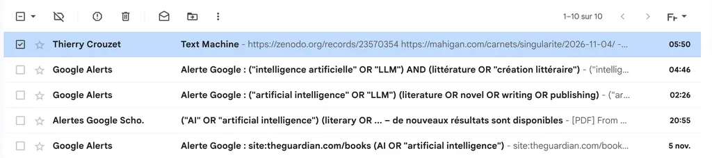
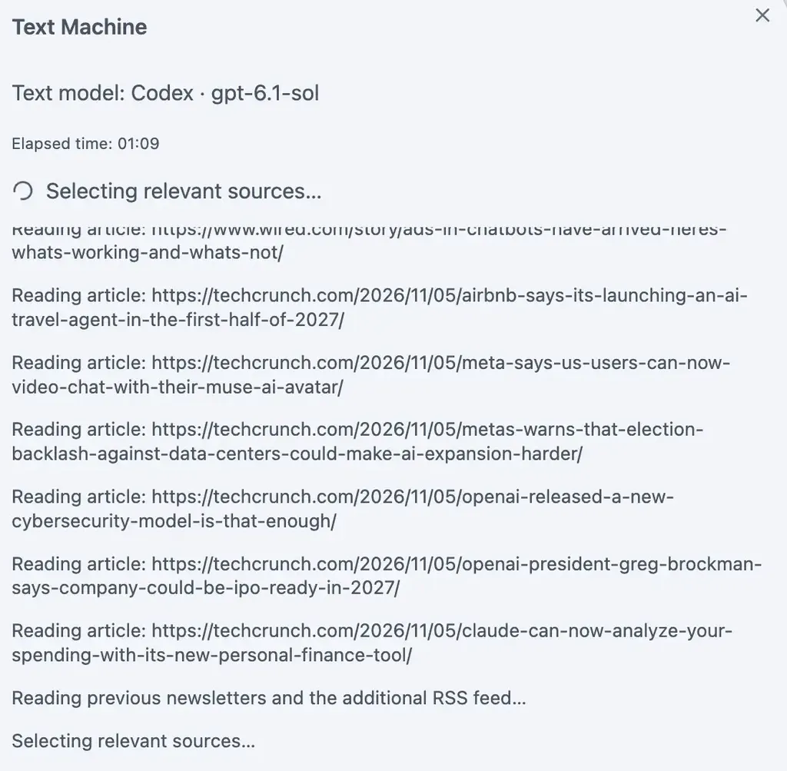

# Text Machine : le Substack littérature et IA

Le domaine de la littérature et de l’IA bouge à une vitesse extraordinaire : pas une journée sans nouvelle expérience, nouvelle étude, nouvelle controverse. Je m’informais de façon désordonnée, faisant confiance au hasard, jusqu’à ce que je fabrique [Text Machine](https://textmachine.substack.com/), une newsletter de veille, [en espérant qu’Hubert Guillaud ne m’en voudra pas trop de participer à l’IA Slop](https://danslesalgorithmes.net/2025/01/13/vers-un-internet-plein-de-vide/).

Mon inspiration première : [la revue de presse matinale sur France Inter](https://www.radiofrance.fr/franceinter/podcasts/la-revue-de-presse). J’avais envie de la même chose sur la littérature et l’IA, mais sans en faire un job à plein temps. Je l’ai donc automatisée. Et [Text Machine](https://community.obsidian.md/plugins/text-machine) est aussi devenu un plugin [Obsidian](https://tcrouzet.com/2026/10/27/obsidian-contre-word/) pour créer ma newsletter, mais il peut servir à en créer sur d’autres sujets.

Le principe : une boîte Gmail reçoit des alertes Google ou des messages envoyés par moi ou par vous, avec l’objet « Text Machine » et, dans le corps du texte, des liens vers des articles. C’est donc potentiellement une revue de presse collective (vous pouvez me demander l’adresse email pour participer).

Des filtres Gmail dirigent les messages vers un libellé « text-machine » ou tout autre nom au choix.

Quand je lance le plugin Text Machine depuis Obsidian, il lit les nouveaux messages, tente de lire les articles s’ils ne sont pas réservés aux abonnés, vérifie leur adéquation avec le thème de la newsletter et s’assure que leur sujet n’a pas déjà été traité les jours précédents. En parallèle, il lit une série de fils d’actualité, dont celui de [*Dans les algorithmes*](https://danslesalgorithmes.net).

Une fois ces informations consolidées, il rédige la newsletter et l’illustre. Cette opération automatique, paramétrable à l’aide de prompts, nécessite Codex, ou une IA locale ou une clé API pour accéder à ChatGPT ou Claude. [La procédure dure cinq minutes environ.](https://github.com/tcrouzet/textmachine/blob/main/doc/processus.svg) Quand la newsletter est prête, elle s’affiche dans Obsidian. J’utilise [To Substack](https://community.obsidian.md/plugins/to-substack) pour la publier.

L’avenir me dira si la méthode m’apporte les informations désirées et si j’ai la patience de lancer la procédure dès que ma boîte mail se remplira. Souvent, mettre en place ce genre de mécanique m’amuse plus que le résultat.

J’ai ainsi perdu l’envie de publier [mon digest dominical](https://tcrouzet.com/tag/digest/). Je le faisais pour Isa et, depuis sa mort, j’ai beaucoup de mal à m’y remettre. J’ai besoin de quelque chose de plus fluide, de plus dynamique et interactif, de vous partager mes trouvailles au fil de l’eau. Je me contenterai de notes sur [Substack](https://tcrouzet.substack.com/notes) et [Mastodon](https://mamot.fr/@tcrouzet).

Rien ne dure dans l’espace numérique : on essaie, on se rétracte. Chez moi, seul le blog se maintient, cette possibilité de diffuser des pensées longues, de dialoguer, de rebondir, mais en prenant le temps et l’espace nécessaires. Il y a les choses passagères, celles qui s’accrochent, deviennent des pratiques, presque des thérapeutiques.

Vous pouvez vous abonner à [Text Machine](https://community.obsidian.md/plugins/text-machine) et me dire ce que je peux améliorer pour rendre la newsletter plus utile, mais ne me demandez pas, comme l’a fait un copain, d’éditorialiser le contenu en détail – je lis, coupe éventuellement, change un ou deux mots. C’est une revue de presse quasi automatique, avec les imperfections propres à toute expérimentation. J’ai au moins la franchise d’être transparent sur la méthode, quand beaucoup d’autres ne le sont pas et tentent de nous faire avaler des couleuvres.

#netlitterature #ia #y2026 #2026-11-6-8h00
