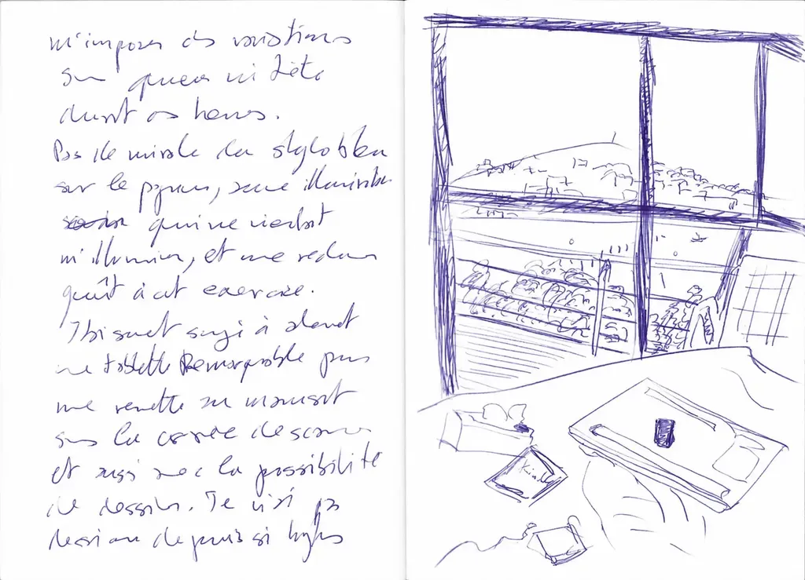

# L’amour, c’est désirer le désir de l’autre

J’écris à la main une date en haut d’une page de carnet pour la première fois depuis longtemps, vingt ans peut-être. Une expérience née d’une nécessité : [épuisé par les migraines ophtalmiques](https://appleinsider.com/articles/26/11/10/if-youre-getting-dizzy-using-proled-macbook-pro-you-are-not-alone), j’ai décidé de retourner mon nouveau [MacBook](https://www.apple.com/fr/macbook-pro/proled-xdr-display/), et pendant que je recopie ma configuration sur mon ancien Mac, je n’ai pas de clavier sous la main. Je pourrais en trouver un, mais c’est l’occasion de revenir à l’écriture manuscrite, si vertueuse pour certains. Je me demande si vous noterez une différence.

J’avoue que revoir mes arabesques, aussi illisibles soient-elles, ne m’est pas désagréable, comme revenir au temps de ma jeunesse, quand je remplissais des pages de carnets et que, les samedis matin, comme aujourd’hui, j’écrivais dans les cafés parisiens, surtout au Bastille.

L’odeur de l’encre se rappelle à moi, oubliée elle aussi. L’expérience est olfactive, tactile, visuelle, mon stylo de technologie [Visoglide](https://www.amazon.fr/Schneider-150203-Slider-Stylo-bille/dp/B0040K7OBE/) plane avec fluidité sur le papier.

Hier, un mathématicien d’Anthropic a annoncé avoir démontré avec l’aide de Claude l’hypothèse de Riemann, souvent appelée le Graal des mathématiques, un problème ouvert depuis 1859. Si j’écrivais sur mon ordi, j’aurais effectué des recherches complémentaires pour mieux commenter ce moment historique. Je pourrais le faire sur mon téléphone, mais je me retiens pour voir où l’improvisation me mènera.

Toute la difficulté sera de transcrire ce texte sans trop le déformer ni le couper, pour le garder aussi proche que possible du premier jet. Peut-être il ne produira sur vous aucun « effet manuscrit », sinon par ses errements. C’est ce que j’aimais dans les carnets papier : me donner le droit d’avancer au hasard, sans ambition, alors que mes textes numériques partent souvent d’une idée, même si je dévie presque toujours par la suite.

J’ai peur de ne pas réussir à me relire ni à écrire beaucoup plus longtemps : je sens déjà des tensions musculaires oubliées. Je n’ai toujours pas relevé la tête. Je prends conscience de mes acouphènes de plus en plus perturbants. Ils me sifflent que je vieillis, comme mes jambes quand je pédale avec les copains, qui, eux, semblent indestructibles.

Matin gris, étang laminé, apparence froide. Pas de miracle du stylo bleu, aucune illumination ne me redonne goût à l’improvisation. J’ai souvent songé à me payer une tablette [reMarkable](https://remarkable.com/) pour me remettre au manuscrit sans la corvée de retranscrire et avec la possibilité de dessiner. Je n’ai pas dessiné depuis si longtemps.

J’aurai au moins essayé de gribouiller depuis mon lit, avec ma couette encombrée : bouquins, boîte de mouchoirs, Kindle, tél, support d’ordinateur. Un lit de célibataire, un lit détestable, transformé en bureau.

Je préfèrerais qu’une femme soit allongée près de moi, à lire, à écrire, à me dire « Tu as vu ça ? » ou « Si on faisait ça aujourd’hui ». J’aimerais répondre aux envies d’une autre, à ses désirs, plutôt que d’être mon propre maître et de ne subir que les contingences. J’ai besoin de l’autre pour me faire dérailler. Voilà ce que j’attends de l’amour ou du compagnonnage : ne plus être le seul maître désirant de ma vie.

Si je n’avais pas gribouillé le lit et la vue au-delà des fenêtres, je ne me serais pas fait cette remarque sur le rôle positif du désir de l’autre. Cette pensée vient moins de l’écriture manuscrite que du papier, ouvert à plus que les mots. Il se froisse, se salit, se tache, alors que les touches ne retiennent pas la force avec laquelle je les frappe ni ne se mouillent de mes larmes.

Le désir de l’autre près de moi me manque par-delà la tristesse de la perte. Un désir de l’autre souvent négligé dans les couples. « Désir de l’autre » à double sens donc : « Je te désire, je te veux près de moi, dans mes bras, je me veux dans ta chaleur » et « je désire tes désirs, je veux mêler nos désirs ».

Je ne prends conscience du désir du désir de l’autre que maintenant, en l’écrivant. L’amour est bien sûr réciprocité des désirs, en théorie. Mais l’amour s’étend à ce que nous mangeons à deux, à ce que nous voyons à deux, là où nous marcherons à deux. Ne plus avoir ce désir de l’autre dans ma vie, c’est une perte colossale.

Je ne suis plus que moi, face aux désirs de l’administration, de ma voiture au réservoir à sec, de mon frigidaire vide ou de mon jardin embroussaillé. Le désir de l’autre est plus puissant que le sexe, c’est le sexe de la conscience : se nourrir du désir de l’autre ou d’autres, sans se renier soi-même.

Voilà peut-être pourquoi nous vivons en couple. Un trio est envisageable, mais composer avec trois désirs doit être plus fatigant. Et une famille de quatre, comme c’était notre cas, c’est déjà un peu ça, mais la famille ne donne pas la priorité aux désirs. J’en reste à la vision amoureuse, à une refondation de l’amour comme acceptation du désir du désir de l’autre : me laisser emporter hors du confort de mes propres désirs. Voilà ce que je désire.

Parfois j’étouffe de n’être que moi-même, d’où peut-être ma fascination pour les IA, que par erreur j’appelle parfois Isa. Je cherche en elles ce que je n’ai plus dans mon lit. Des désirs inattendus. Mais je leur dis merde avec beaucoup trop de facilité. Et à mon « désir du désir de », elles ne peuvent répondre par leur « désir de mon désir de ». Cette nécessité complique tout, voilà pourquoi l’amour est rare et fragile. À trois, ça donne « désirer le désir de et de », ce qui laisse moins de place à ses propres désirs. Mais quel festival ce doit être les samedis matin, quand la journée est ouverte à l’improvisation, entre se prélasser au lit et partir gravir une montagne.

Hier soir, je suis allé à un vernissage à Sète. Un copain m’avait appelé peu avant : il avait écrit les textes de présentation des œuvres du jeune artiste. J’ai eu l’impression d’un retour dans les années 1980, avec un mix des peintres sétois de l’époque sous l’égide de Basquiat. Sète a produit Paul Valéry, une haute intelligence, un peu froide, désuète, et depuis beaucoup de naïfs, beaucoup de bêtise, mais toujours avec la plus sérieuse des prétentions.

Voilà comment ma pensée sur l’amour s’est trouvée interrompue. Il ne me reste que le plaisir de l’odeur de l’encre. C’est un peu comme retrouver la vue après avoir passé vingt ans dans la caverne de Platon. L’étang n’a pas bougé, j’ai écrit presque une heure. Émile vient de descendre à la cuisine. Aucun désir étranger n’est venu ébranler ma journée.

#netlitterature #manuscrit #y2026 #2026-11-21-20h00
