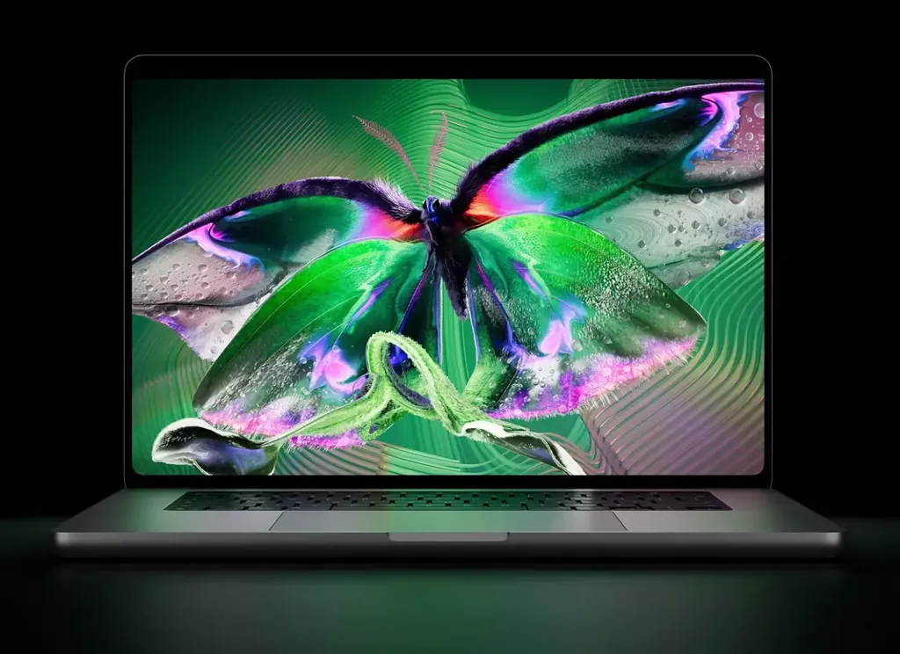
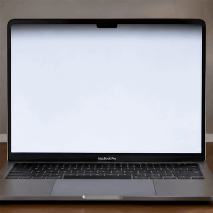

# L’IA ou la fin de l’inattendu

Une mésaventure avec mon nouveau MacBook Pro me donne à voir un monde qui n’a plus aucun rapport avec celui que nous connaissons.

Jeudi 12 novembre, je reçois mon [MacBook Pro avec écran PROLED XDR](https://www.apple.com/fr/macbook-pro/proled-xdr-display/). Une bête de course, compacte, légère, avec un écran aux couleurs éclatantes, à la définition extraordinaire, mais, le soir, des migraines ophtalmiques commencent et s’intensifient au cours du week-end. Les exercices d’orthoptie ne m’apportent guère de réconfort.

Mardi matin, je suis prêt à renvoyer la machine et à revenir sur mon vieux bousin, qui marche à merveille, mais reste trop limité pour installer des IA en local. Avant d’agir impulsivement, j’effectue quelques recherches.

Je découvre vite que le nouvel écran Apple utilise la technique PWM (_Pulse Width Modulation_, modulation de largeur d’impulsion). Dès que nous voulons réduire la luminosité sous 100 %, le PWM entre en action : les pixels s’éteignent et s’allument plus ou moins longtemps à une fréquence de 240 Hz. Certaines personnes peuvent percevoir ce scintillement, appelé PWM flickering. [Des utilisateurs signalent fatigue visuelle, maux de tête, vertiges, nausées et difficultés à lire.](https://www.notebookcheck.net/Apple-MacBook-Pro-OLED-PWM-flickering-causes-headaches-for-many-users.1451736.0.html) Je m’y reconnais. Mais pourquoi vendre une merde pareille ? Pourquoi utiliser une solution nocive pour certains utilisateurs ? Pourquoi pas de mise en garde lors de la commande ?

Je suis furieux, mais poursuis mes recherches. Quand la luminosité est à 100 %, plus de PWM : nul besoin d’éteindre et de rallumer les pixels pour réduire la luminosité. Tout de suite, je vois mieux, mais l’écran est presque toujours aveuglant. J’ai alors une idée simple : pourquoi ne pas garder la luminosité matérielle à 100 % et changer la palette de couleurs des applications, ce qui reviendrait à créer une baisse de luminosité logicielle plutôt que matérielle.

Une table de correspondance ou LUT (_Look-Up Table_) suffit. Je n’ai trouvé aucun logiciel proposant cette seule fonction, [BetterDispay](https://betterdisplay.pro/) n’y parvient qu’au prix d’une complexité indescriptible et ne prend en compte ni les touches de luminosité ni les variations automatiques selon la lumière ambiante. Et là, c’est comme si je sautais dans un autre monde : je demande à Codex de me développer [FlickerGuard](https://github.com/tcrouzet/FlickerGuard), une application pour régler la luminosité logicielle tout en maintenant la luminosité matérielle à 100 %.

Apple n’a sans doute pas choisi cette solution parce qu’une LUT logicielle :

* modifie la précision des couleurs et leur calibration ;
* réduit les hautes lumières et les détails dans les ombres ;
* augmente potentiellement la consommation électrique, donc la dissipation thermique, mais de façon modérée : réduire la luminosité avec des couleurs plus sombres réduit aussi la consommation.

Ces altérations sont problématiques pour l’édition de photos ou de vidéos. Voilà pourquoi FlickerGuard se désactive automatiquement dans les applications de son choix ou quand on visionne une vidéo en plein écran. Le reste du temps, il ne pose aucun problème, surtout quand, comme moi, on passe son temps devant du texte. Au minimum, Apple aurait pu proposer une commande pour basculer entre les deux modes de gestion de la luminosité.

Pas grave, Codex a fait le job pour moi. Et c’est là que tout change. Le bricolage exige encore un poil de compétence technique, mais plus beaucoup. Dans quelques mois, il n’en demandera plus du tout. Quand nous aurons besoin d’une fonction, nous ne chercherons plus à installer un logiciel : nous décrirons notre besoin et le logiciel sera créé pour nous, puis évoluera avec nos besoins. L’ensemble de l’environnement de travail sera une IA. Ce que nous appelons aujourd’hui un système d’exploitation se transformera en IA.

Cette évolution dépassera le cadre informatique. Les livres, les films, les musiques s’adapteront, se transformeront. Rien que d’y penser, j’ai mal, tant pour moi une œuvre est associée à une structure stable, capable de traverser le temps, de nous immortaliser.

L’IA fera-t-elle disparaître les créateurs ? Parce qu’un créateur, on l’oublie souvent, surtout à notre époque de grande marchandisation, ne nous donne pas ce que nous voulons, mais nous dérange, nous déplace, nous force à voir ce que nous ne voulions pas voir. Il nous bouscule, nous met mal à l’aise, nous transforme, parce qu’il nous raconte son propre chemin à travers la vie.

D’une certaine façon, nous sommes déjà prêts à basculer dans le tout IA, où plus rien de profondément original ne nous sera accessible, puisque nous consommons pour l’essentiel de la culture de masse. Alors nous avons un devoir de résistance, non pas à l’IA, mais à l’uniformisation amorcée plusieurs décennies avant elle. Nous aurons à composer entre le sur-mesure et ce qui fait mal, qui gratte, qui secoue les puces. Nous aurons besoin de courage, comme quand nous préférerions rester au lit plutôt qu’aller faire du sport. Pourtant, quand nous rentrons, nous nous sentons plus vivants et ne le regrettons pas. L’IA pourrait tuer la curiosité en comblant nos désirs immédiats. Notre combat contre la normalisation ne fait que commencer.

#netculture #ia #y2026 #2026-11-18-18h00
