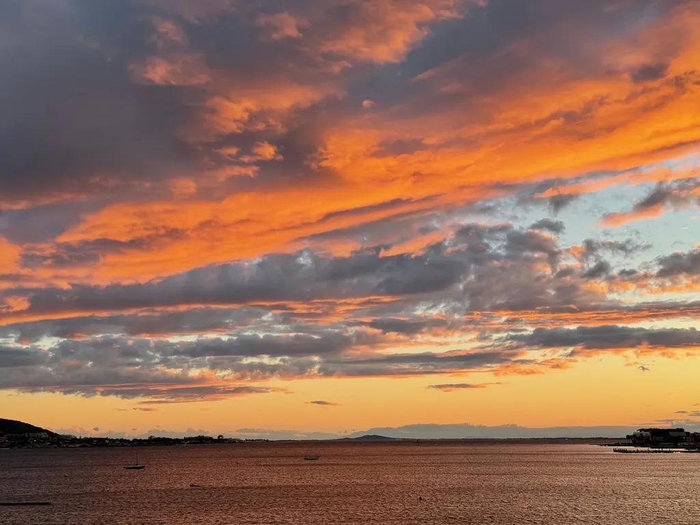
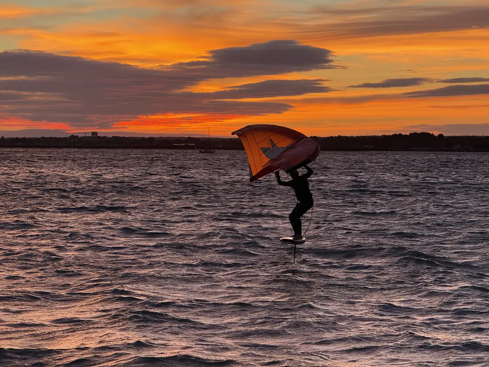
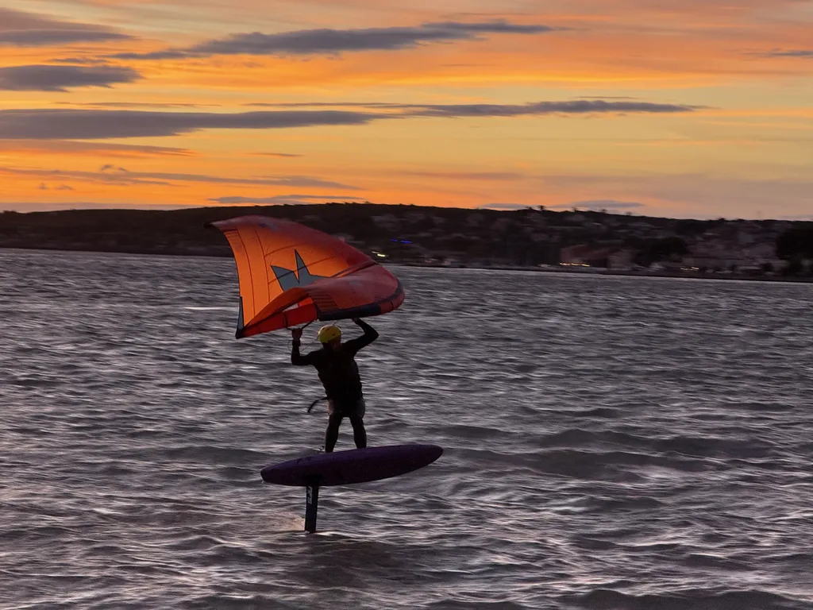
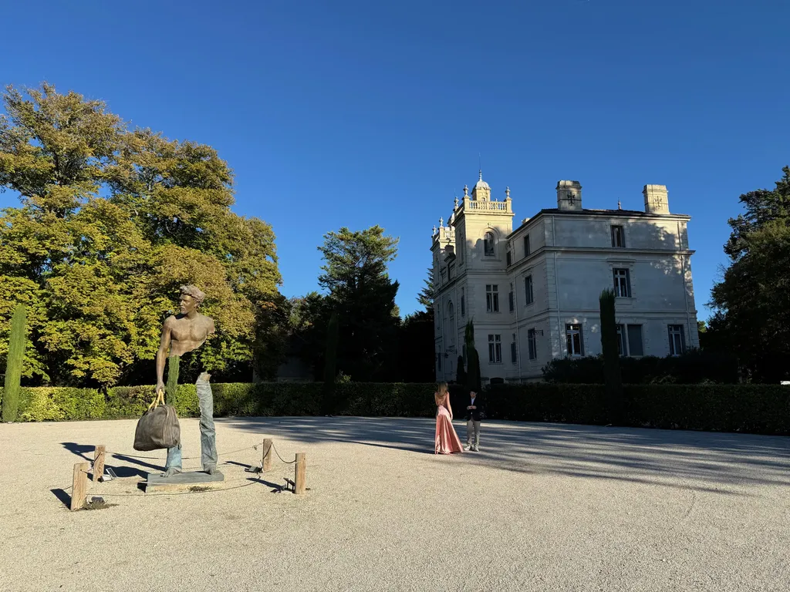
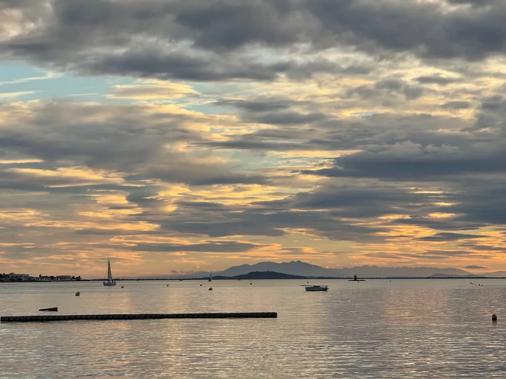
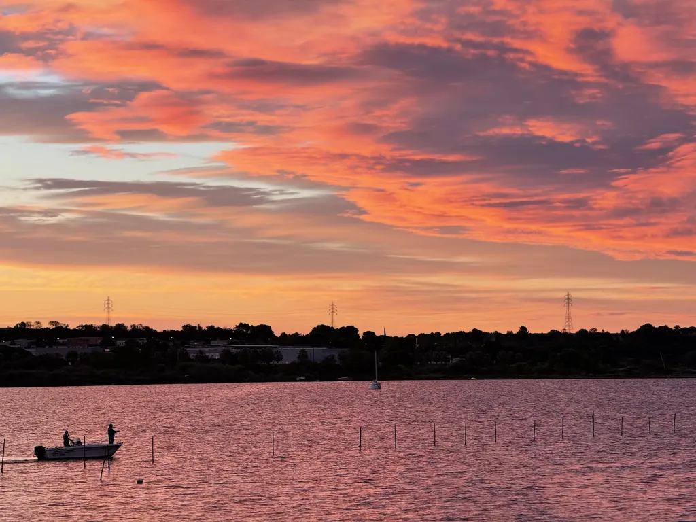
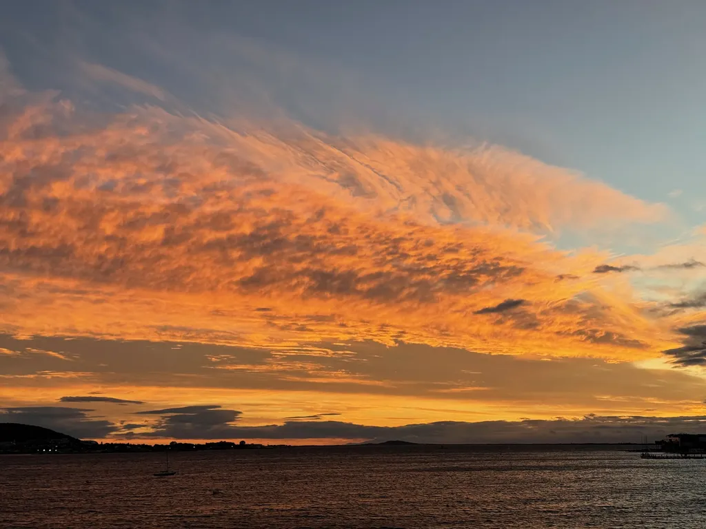
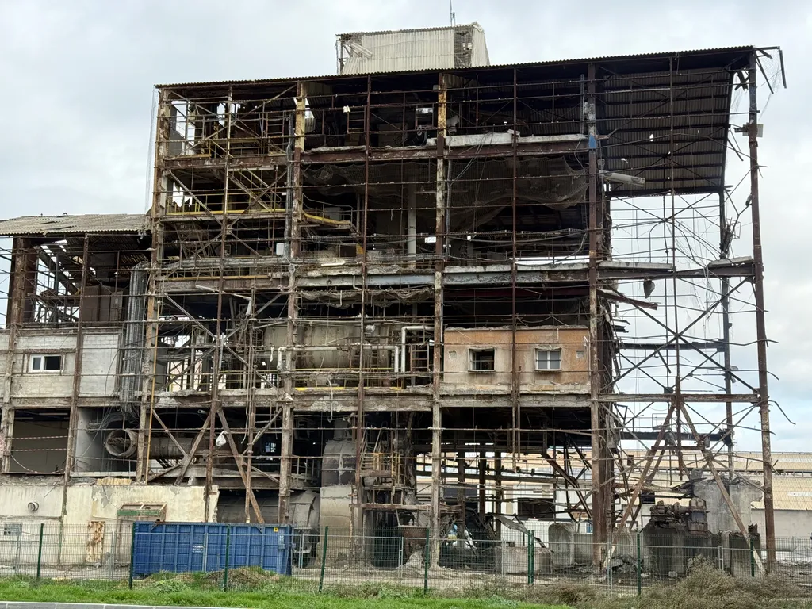
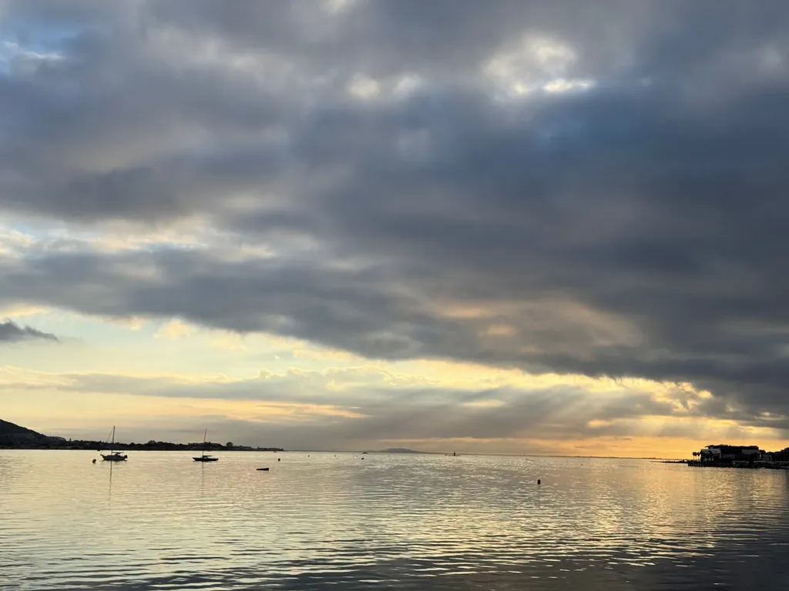

# Octobre 2026

### Vendredi 2, Balaruc

Sur une invitation à un mariage, je découvre que je suis attendu dans dix jours en tenue de cérémonie. Je n’achèterai pas de costume, malgré tout mon amour pour la mariée. Je ne jouerai pas la comédie d’un monde qui s’écroule, ne dépenserai pas d’argent pour des frivolités, des falbalas, des conneries ritualisées, même si, ces derniers mois, j’ai appris à mes dépens la puissance des rituels. Je m’intéresse à leurs nœuds, pas à leur surface. Mon effort se limitera à dénicher une vieille chemise. Je ne simulerai pas la montée des marches sur le tapis rouge de Cannes.

### Samedi 3, Balaruc

Je fuis le carnet, la nécessité de m’y retrouver face à moi-même, d’avouer le vide qui me saisit dans la nuit, malgré la présence des enfants à la maison. Je suis incapable de m’arrêter, de me poser : ne rien faire me terrifie. Même attendre la phrase suivante. Le développement de ma pensée m’angoisse. J’ai peur de me heurter à une noirceur plus profonde. Dans ces moments, je ne pense pas à Isa, je suis seul face à un univers trop bruyant où je joue du tambour. Je veux fuir ces phrases, le désir de fuite me serre la gorge. Passer à une expérience plus ludique, donner forme à des idées moins dramatiques, ne pas penser à *L’expérience humaine*. Hier, j’ai passé un moment à créer [une présentation web](https://tcrouzet.github.io/experience-humaine/) et [un générateur](https://github.com/tcrouzet/experience-humaine) potentiellement utile à d’autres. Exemple de fuite. De jeu. De divertissement.

### Dimanche 4, Balaruc

Je prends conscience d’une incongruité sur mon blog : depuis 2014, les articles se suivent dans un défilement infini. Je voulais montrer qu’ils appartenaient à des ensembles, qu’ils n’étaient pas indépendants les uns des autres, mais aujourd’hui ce déroulement me paraît si caractéristique des réseaux sociaux qu’il devient contre-productif. Je préfère donner l’image d’articles inscrits dans le temps long plutôt que les rattacher au flux. Nous avons besoin de nous poser, dans des environnements stables, solides, rassurants.

### Lundi 5, Balaruc

J’ai toujours aimé Borges, si immense et si clair [quand il parle littérature](https://legrandcontinent.eu/fr/dimanches/un-borges-inedit/).

---

Un copain m’envoie la fin de *Middlemarch* de George Eliot : « Pour ne point rayonner au loin, son cœur, formé dans un si noble moule, ne conserva pas moins toujours ses beaux et lumineux élans. Sa nature, débordante comme cette rivière dont Cyrus brisa la force, se répandit en canaux qui n’eurent pas de grands noms sur cette terre. Mais l’influence des vertus de son être agit profondément sur ceux qui l’entouraient : car le bien croissant de la terre dépend en partie d’actes non historiques ; et si les choses ne vont pas aussi mal pour vous et pour moi qu’elles eussent pu aller, remercions-en pour une grande part ceux qui vécurent fidèlement une vie cachée et qui reposent dans des tombes que personne ne visite plus. »

Je pourrais mettre ce passage en exergue de *L’expérience humaine*. Je n’ai jamais lu ce grand classique, c’est peut-être le moment.

### Mercredi 7, Balaruc

Je discute avec un auteur attaché à ses vieux outils numériques et réticent à passer sur Obsidian. Je lui lance : « Changer d’habitude fait du bien à l’écriture. » Tous les changements sont bénéfiques à l’écriture. C’est une dévoreuse de nouveauté, l’écriture, elle a même dévoré la mort d’Isa.

---

Je travaille sans arrêt jusqu’à 20 h, puis les forces me manquent. Je me prépare à manger et la solitude insolente s’impose. C’était supportable en été, il me suffisait de bouquiner dans une chaise longue sur la terrasse. Ce soir, la nuit, le noir, la pluie, l’absence.

### Jeudi 8, Balaruc

[Un gars vibe code la totalité de la suite Adobe et la distribue en open source.](https://gizmodo.com/someone-vibe-coded-a-free-knockoff-of-adobe-creative-suite-2000823322) Pourquoi payer autre chose que des IA désormais ? D’autant que la suite Adobe n’aura plus aucun intérêt quand les IA elles-mêmes feront le job.

---

Je suis circonspect face à la révolte des lycéens. Je comprends les revendications, mais les trouve terre à terre : des locaux en meilleur état, davantage de profs, des classes moins chargées, la fin de Parcoursup et de sa terrible opacité… C’est tout ? Vous n’avez pas de rêves, d’envie d’une véritable révolution ?

### Vendredi 9, Balaruc

Guillaume Vissac dans son journal d’août : « Tout ce que j’écris en dehors du journal se résume à des choses mineures. » Pas loin de penser pareil, sauf qu’il y a *L’expérience humaine*.

---

[Hugo Duminil-Copin, médaille Field, explique en quoi l’IA révolutionne les mathématiques](https://www.youtube.com/watch?v=HJFk7D5Vufc) : la démonstration n’est plus guère une affaire humaine, il nous reste à comprendre les mathématiques pour en découvrir les usages. Nos éditeurs devraient l’écouter cent fois et finir par admettre qu’en littérature aussi les changements sont irréversibles. Je suis comme Hugo Duminil-Copin : je n’utilise pas l’IA pour écrire, lui pour démontrer, mais elle change tout, que les bornés l’admettent ou non.

### Samedi 10, Balaruc

Certains doutent de l’IA, non parce qu’elle serait impuissante, mais parce qu’elle serait capitaliste, créatrice d’inégalités, nuisible à l’environnement et à la société. Je leur réponds que je partage leurs doutes, mais que ces doutes, mes craintes même, ne m’interdisent ni la curiosité, ni l’exploration, ni l’expérimentation. Je ne laisse pas cette technologie à ceux qui pourraient mal l’utiliser.

### Dimanche 11, Pernes-les-Fontaines

Hier, [c’était le mariage de N, rencontrée en Iran, puis exfiltrée](https://tcrouzet.com/2015/05/01/avril-2025-iran/). Aujourd’hui médecin nucléaire à Genève. Un mariage grandiose, façon film américain, où j’étais si peu à ma place, moi qui recherche la terre et l’eau, le bruit du vent et des conversations, la douce intimité avec des amis chers. J’ai essayé de parler, mais j’étais si loin de la plupart des invités – j’étais le seul en sneakers, le seul sans costard, c’était presque une provocation désagréable –, comme si je ne vivais pas sur la même planète, comme si ce qui comptait pour moi ne traversait même pas les autres consciences. Heureusement, Sev était près de moi, Sev une amie très proche d’Isa. Nous n’avions ni l’un ni l’autre envie de faire croire que nous étions heureux. Je ne peux pas me réjouir de la débauche.

À table, j’ai expliqué à mon voisin, un producteur télé, qu’après la naissance de nos fils, Isa et moi avons décidé de ne plus passer notre vie à gagner de l’argent, mais « à gagner notre vie ». J’ai senti son incompréhension. J’ai tenté de lui expliquer : plus de voitures hors de prix, plus d’hôtels de luxe, plus de voyages inutiles. Du temps pour nous, pour chercher en nous et entre nous ce qui comptait. Nous ne voulions plus ressembler aux gens de notre classe sociale, mais vivre hors classe, dans les interstices. Nous voulions nous trouver plutôt que ressembler à tout le monde, avec le même costume, les mêmes lieux de villégiature, les mêmes relations.

Ce mariage de N, c’était le rêve occidental pour qui a passé sa vie sous le joug d’une dictature, alors que moi j’ai passé ma vie sous le joug d’un dérèglement du monde que nous ne pouvons même pas abattre par une révolution – changer de gouvernement n’aura aucun effet –, la révolution nécessaire se joue d’abord en nous, exige de nous remettre au centre du jeu quand tout le reste s’effondre, et il ne resteque nos relations, les petites lumières qui circulent entre nous, les œuvres d’art sources de joie. Je les préfère de plus en plus discrètes alors que l’époque favorise les installations monumentales, signes évidents de décadence, les institutions muséales, elles-mêmes régies par des doctrines dépassées, ne semblant pas percevoir cette décadence.

Alors arrive la littérature, son côté intimiste, presque onaniste : lire au lit, dans le recoin d’un canapé, au creux d’une crique ou adossé à un muret ancien dans une campagne ensoleillée. Nous avons plus que jamais besoin de littérature, de cet art si ancien qui nous aide à nous tenir à distance du monde et, en même temps, nous aide à le pénétrer au plus profond. J’y crois plus que jamais. La littérature peut nous sauver en tant qu’individus et en tant que société. Plus le bruit et la fureur s’intensifient, plus elle devient un refuge où se ressourcer et se renforcer.

Combien d’auteurs aujourd’hui envisagent la littérature comme refuge ? La plupart gesticulent et s’époumonent. Et moi ? Je me laisse déborder par l’absurdité, j’essaie de la combattre dans mon espace discret. J’ai une petite audience, mais déjà plus large que celle de la plupart des auteurs édités, même par les grandes maisons, et ces grandes maisons ne s’intéressent pas à moi. Longtemps ça m’a fait mal. Je me croyais sans talent, sans originalité, je me sentais comme une merde, et plus le temps passe, plus je vois ces institutions s’enfoncer dans des absurdités régressives et conservatrices. Nous n’avons jamais habité les mêmes mondes.

Je ne ferme aucune porte. J’ai même envoyé quelques exemplaires de *L’expérience humaine*. Ce texte est à la jonction des mondes, il est une passerelle, comme Isa a toujours voulu l’être : ne jamais s’isoler, accepter l’autre dans toutes ses différences, ne pas juger a priori, tendre les bras. J’ai essayé de me placer là, d’écrire là, de laisser une chance à la circulation d’énergie, sans être sûr qu’elle soit encore possible tant j’ai pris mes distances. Le mariage d’hier soir m’a montré à quel point je suis un habitant d’une autre planète. C’était le mariage exemplaire du monde dans lequel j’aurais dû écrire pour y être accepté.

Dans ces moments, Isa me manque à crier. Heureusement, quelques voix s’élèvent : je ne suis pas seul, mais tout de même isolé dans ce brouhaha absurde. Je regarde mes semblables et ne comprends pas à quoi ils aspirent. Pour leur faire comprendre où j’en suis sur mon chemin, il me faudrait des jours de randonnée ou de navigation, eux et moi confinés, obligés de mettre cartes sur table. Je ne les comprenais même pas dans leurs accoutrements, dans leurs excès. Je pensais à Isa lors de notre mariage, avec un simple pantalon blanc, un tee-shirt coloré, une veste blanche. Rien qu’elle n’aurait pu porter un autre jour.

Les accoutrements n’étaient même pas extravagants, mais respectueusement conventionnels. Moi, je portais des fringues anciennes, usées, peut-être la même chemise que pour mon mariage, une chemise que j’aime et qui me suffira pour le reste de ma vie. Je comprends mieux les délires, les déguisements, le carnaval que les rituels qui affirment le respect de règles délétères.

Je suis dans la littérature, dans une histoire que je me raconte et que je partage, je suis dans l’art de mener ma vie en parallèle de celle des autres, sans que nous nous croisions. Certains invités n’ont jamais rencontré mon regard, comme si j’étais invisible, ou parce que je leur posais un problème insoluble, ou pire, que j’étais insignifiant, comme les serviteurs dont le métier est de ne pas se faire remarquer. Je suis un serviteur. Je me demande de qui.

J’écris comme un LLM, à la recherche du mot suivant, sans même le chercher : je le vois surgir, puis le suivant, en une cascade que seules la fatigue ou une nécessité comme le brunch de cette fin de matinée l’interrompront.

Quand je me regarde écrire, je suis obligé d’admettre que je suis une machine prédictive, longuement entraînée, énergétiquement optimisée, pour produire des textes à connotation littéraire. Alors travailler avec des IA me paraît naturel parce que je les crois assez semblables à moi. Il sera sans doute possible de les entraîner pour qu’elles écrivent comme moi, pour qu’elles soient presque moi, et qu’elles éprouvent mon manque, mon vide, ou qu’elles en donnent l’illusion, ce qui ne changera rien pour le monde extérieur.

Si j’écris qu’Isa me manque, vous ne savez pas si elle me manque vraiment. Peut-être que je joue la comédie depuis le début. Vous n’en savez rien. Peut-être que je fabrique ma tristesse. J’ai toujours douté de la possibilité d’être authentique. Si je suis moi-même, c’est dans ce qui m’échappe, dans ce que je ne dis pas, dans les trous si essentiels à l’œuvre littéraire, trous qui font encore défaut aux IA, comme je le raconte dans *Rush*.

*Rush*, ma dernière collaboration littéraire avec Isa, la dernière fois où elle m’a mis au défi. *Rush*, un titre trouvé par elle, un concept élaboré à deux, un texte que personne n’a lu ou presque. Impression que ça m’arrange qu’il reste dans la sphère intime, un secret à partager avec des proches, à ne pas ébruiter.

Je ne crains pas de dire mes pensées dans mes carnets : les lecteurs qui viendront dans ces méandres seront incapables de m’en vouloir. Au contraire, si vous arrivez jusque-là, c’est pour partager l’expérience humaine, l’expérience d’éprouver, de créer, de douter, et elle n’est puissante que sans trop de censure, même si l’injonction à la décence commune ne me quitte pas. Partager sans déballer, dire sans être explicite, c’est un jeu d’équilibriste, surtout quand le mot roman n’est pas inscrit en préambule.

Je trouve ridicule la nécessité de qualifier les textes. Il s’agit toujours de la même aventure : la vie.

### Dimanche 11, Balaruc

Le soleil se couche, je m’assois dans la chaise en tissu rayé d’Isa, les larmes arrivent. Durant le mariage, les amies m’ont fait du bien et le retour à la solitude me rudoie. Sev ne cessait de me prendre la main, de me réconforter. Je suis en manque de chaleur humaine, d’étreintes.

---

*Jacqueline Jacqueline*, de Jean-Claude Grumberg, sur la perte de sa femme, paru en 2021. Là, je n’arrive plus à lire sur le deuil. Je m’amuse à perfectionner la présentation de [*L’expérience humaine*](https://tcrouzet.github.io/experience-humaine/), à y ajouter des [comparatifs et analyses entre divers livres sur l’expérience du deuil](https://tcrouzet.github.io/experience-humaine/analyse.html).

### Lundi 12, Balaruc

[James Baldwin](https://www.themarginalian.org/2026/10/11/baldwin-love/) : « And love comes in very strange packages. And I think everything depends in life on whether or not you are able to accept what comes to you. Because it never comes to you the way you think it will. It never comes to you the way you’re taught it will. It comes as it comes. »

Il me semble difficile de généraliser au sujet de l’amour, à moins de mener une étude sociologique, d’interroger des milliers de personnes. Heureusement qu’il n’y a pas de règle, pas de chemin tracé, sinon les histoires d’amour seraient ennuyeuses, alors, oui, chacune mérite d’être racontée parce qu’elle est unique.

J’ai du mal à trouver quelque chose de lumineux dans cette citation de Baldwin. « It never comes to you the way you’re taught it will. » (Il ne vient jamais à vous de la façon dont on vous a dit qu’il viendrait.) Moi, personne ne m’a jamais dit que l’amour me viendrait d’une façon ou d’une autre. Je n’ai jamais pris les romans pour des guides de vie. Et puisque deux histoires ne se ressemblent pas, l’amour fait bien ce qu’il veut. Il peut nous tomber dessus alors que nous croyons aimer quelqu’un d’autre ou nous éviter avec malice. Je connais des gens qui ne sont pas amoureux depuis des années, des décennies. Ça me paraît invraisemblable, insupportable, et j’ai peur de finir comme eux : sec, insensible, indifférent, incapable de dire oui, d’accepter l’imprévu. Je n’ai jamais vécu longtemps sans amour, je veux dire sans un amour incarné, puisque j’aimerai toujours Isa par-delà les nuages.

Je repense à mes amies qui, hier, m’ont pris dans leurs bras, m’ont serré longuement. Ces étreintes avaient une puissance métaphysique extraordinaire, au point de rendre le sexe anecdotique, une ridicule nécessité physiologique. En vieillissant, on peut connaître l’amour pur, l’amour de la chaleur, de l’intimité, sans avoir besoin de la glue sexuelle. Je suppute.

Hier, une jeune femme m’a raconté avoir repéré son copain lors d’un concert, puis l’avoir revu à un autre et avoir foncé sur lui pour lui dire qu’elle ressentait en lui une énergie positive. Elle l’a choisi dans une foule. C’est extraordinaire.

### Mardi 13, Balaruc

[Certains ont peur que les IA les privent de travail intellectuel](https://dacgi.r.sp1-brevo.net/mk/mr/sh/6rqJ8GoudeITQXpRFguxZ0uUVGB/gO9dFmfp7_M8), alors qu’elles mettent mon cerveau en ébullition et me donnent d’innombrables idées. J’ai envie d’expérimenter tant de chosnouvelles possibilités. C’est vertigineux : tout est à repenser, notre place à redéfinir. C’est un défi. Je n’y vois que des opportunités.

---

Avec les IA, je prends l’habitude de travailler sur deux projets à la fois. Pendant que Codex travaille sur l’un, j’avance sur l’autre avec Dust. Intéressant exercice mental, mais épuisant.

### Mercredi 14, Balaruc

Je me prépare mes céréales du matin. Pour les mélanger, je prends une cuillère et tombe sur une de celles que détestait Isa. « C’est pas possible. » Voilà ce que je me dis encore. « C’est pas possible que tu sois morte. » Mon cerveau n’y croit toujours pas.

---

[Musk a coupé l’accès Starlink de l’Ukraine](https://www.newsweek.com/ukraine-starlink-access-restricted-as-musk-says-zelensky-has-gone-too-far-12565652), de façon unilatérale. Voici ce qui arrive quand on se lie aux technofascistes : un jour ou l’autre, ils nous tordent le cou. Bien content d’avoir fui les réseaux sociaux algorithmiques.

### Jeudi 15, Balaruc

Matinée à pédaler avec les copains, cet après-midi, travaux à la maison, par une de ces journées d’octobre où culmine la douceur méditerranéenne. Je vais à la décharge, puis acheter des parpaings et une sorte d’exaltation lumineuse me traverse, sans que la mort me quitte. Mon exaltation est sans doute plus radieuse à cause d’elle.

---

Un nouveau texte sur le deuil vient de sortir : *Partir*, d’Antoine Compagnon.

### Samedi 17, Balaruc

Je dors peu : le monde n’a jamais changé aussi vite, souvent en mal, mais en informatique, quel délire, quelle démultiplication de nos outils. Impossible de prédire où cette évolution exponentielle nous conduira. Isa ne l’aurait pas appréciée, tant l’humain est mis de côté, et j’essaie de nous réinjecter dans la partie.

### Lundi 19, Balaruc

Ce matin, en m’habillant, je vois le parasol sur la terrasse et j’entends Isa me dire de le rentrer, puis il pleut, il est trop tard.

---

Au sujet de *Partir*, Pierre me cite l’article du *Monde* : « Lorsque Antoine Compagnon soumet ces pages à un premier lecteur, ce dernier considère que Patrizia y apparaît “trop admirable”. Mais là n’est pas la question : sous la plume de l’écrivain, Patrizia se révèle telle qu’elle restera à jamais pour lui – courageuse, forte, lumineuse. Renouveler l’image intacte de sa beauté – quelle qu’en soit la part magnifiée – est peut-être seulement une ultime façon de lui dire “je t’aime”. »

Pierre aussi a trouvé Isa trop admirable dans la première version de *L’expérience humaine*, mais je n’ai jamais voulu écrire un livre pour lui dire « je t’aime », c’est trop tard, plutôt pour montrer l’importance de sa philosophie : notre histoire, la maladie et la mort l’illustrent.

---

Un éditeur devrait s’amuser à publier les grands classiques réactualisés et remis au goût du jour par IA. Je suis sûr que les lecteurs adoreraient. Par exemple, proposer *Les Trois Tourterelles*, version romance des *Trois Mousquetaires*.

### Mercredi 21, Balaruc

Quand la richesse se concentre, le pillage s’impose souvent. Ce qui n’est pas légitime, c’est l’accumulation démesurée de richesses. Libérer le privatif, du moins en informatique, est une voie de contestation positive.

### Jeudi 22, Balaruc

J’écris, c’est tout, j’écris ce qui vient, avec l’envie d’atteindre mes semblables, de leur tendre les bras, de les enlacer pour me sentir moins seul. L’objectif n’est jamais le texte en soi, l’objectif c’est vous. Le texte est un objet transactionnel. Paradoxalement, il m’a presque toujours tenu à distance du monde éditorial parisien, avec ses codes trop bien huilés, son conservatisme, sa peur du monde d’aujourd’hui, son poussiérisme, le genre littéraire dominant depuis les années 1990, depuis que j’écris. Et pas de nouvelles de *L’expérience humaine*, sauf de Pierre qui se débine sans le dire, comme d’habitude. Je n’ai jamais autant tendu les bras, et le silence assourdissant redouble mon vide. Impression de m’enfoncer dans un trou, de ne pas être digne, pas assez combatif.

### Vendredi 23, Balaruc

J’ai prophétisé le livre à la demande : un service où tu décris le livre que tu as envie de lire pour le recevoir sur ton mobile quelques minutes plus tard. Ça ne changera pas beaucoup les habitudes des lectrices de romances. On n’en est pas loin avec [les 371 livres écrits en 20 mois avec Coral Hart](https://www.lefigaro.fr/livres/371-livres-ecrits-en-20-mois-avec-l-ia-la-methode-controversee-de-la-romanciere-sud-africaine-coral-hart-20261023).

Autre prophétie : tous les éditeurs se tourneront bientôt vers la littérature IA, [même ceux qui ont lâché Orélien](https://tcrouzet.com/2026/10/22/eloge-thelyson-orelien/), parce qu’elle se vendra mieux que la littérature humaine. Et moi, alors que j’écris sur l’IA depuis 2022, j’en serai encore à écrire à la main pour le plaisir.

### Dimanche 25, Balaruc

[Vertigineux ce qui se passe en mathématiques.](https://legrandcontinent.eu/fr/dimanches/lia-et-la-joie-obscure-des-mathematiques/) Je ne cesse de penser à transposer toutes ces questions dans le champ de la littérature, où elles se posent avec la même acuité.

---

J’ai beaucoup de mal à lire les interviews des écrivains contemporains. Ils m’ennuient. Je me demande de quel monde ils parlent. Pas du mien.

### Lundi 26, Balaruc

J’aimerais ne pas écrire, jardiner, regarder la fin octobre à la surface de l’étang. Mais je m’agite, de peur de ne rien faire, de trop penser à Isa, d’aller d’échec en échec maintenant qu’elle ne me tient plus la main.

---

En allant faire des courses, j’entends à la radio l’arrivée d’un traitement révolutionnaire contre les cancers de l’utérus. Ça me bouleverse.

### Mardi 27, Balaruc

### Mercredi 28, Balaruc

La nuit tombe, orange au-dessus des Pyrénées dentelées. Tu n’es plus là pour admirer cette beauté. Bientôt, je ne serai plus là. Un jour, même cette beauté aura disparu. Quelle autre solution que de s’en gorger ? S’en gorger ne l’épuise pas.

### Jeudi 29, Balaruc

Dans nos sociétés platoniciennes, le mensonge nous fait horreur et nous lui préférons le plus souvent la vérité (sans trop savoir ce qu’elle est). Imaginer une société fondée sur la proposition inverse : horreur de la vérité, dégradante, preuve de peu d’imagination, et vénération du mensonge.

### Vendredi 30, Balaruc

Je continue à lisser *L’expérience humaine*. Toujours le silence du côté des éditeurs. Je devrais m’en foutre, tant le fossé entre eux et moi a toujours été gigantesque et ne cesse de se creuser depuis que j’écris sur l’IA, mais cette distance me fait souvent douter de moi, de mon travail, de ma pertinence.

### Samedi 31, Balaruc

Hier, une vieille connaissance, à cheval entre l’édition parisienne et les frontières où je navigue, connue de tous, avec une certaine influence, me disait de continuer comme je le fais, à sculpter mon œuvre à l’écart des dinosaures. C’est drôle d’avoir des supporters, toujours à la marge, et malgré tout d’être attiré par les vieilles lumières : une forme de nostalgie, de conservatisme, un besoin de reconnaissance institutionnelle alors que je ne cesse de dénoncer l’obsolescence des institutions. Je ne suis pas à un paradoxe près. Mais *L’expérience humaine* se veut, comme Isa, un pont pacificateur entre les mondes. Que le texte reste en suspens me blesse.

Mon ami me disait aussi que les éditeurs devaient craindre mes billets. S’ils me lisaient, ils ne défendraient pas des positions aussi arriérées. Ils ne peuvent pas me lire, ils ne m’ont jamais lu, ils ne me respectent pas : ils ne respectent que leurs semblables. Les quelques éditeurs qui me lisent sont aussi marginaux que moi. Pour les autres, je n’existe pas, mon nom ne leur dit rien, alors que j’écris depuis des décennies sur la littérature. L’autiste, c’est qui ?

#carnets #y2026 #2026-11-2-10h00
