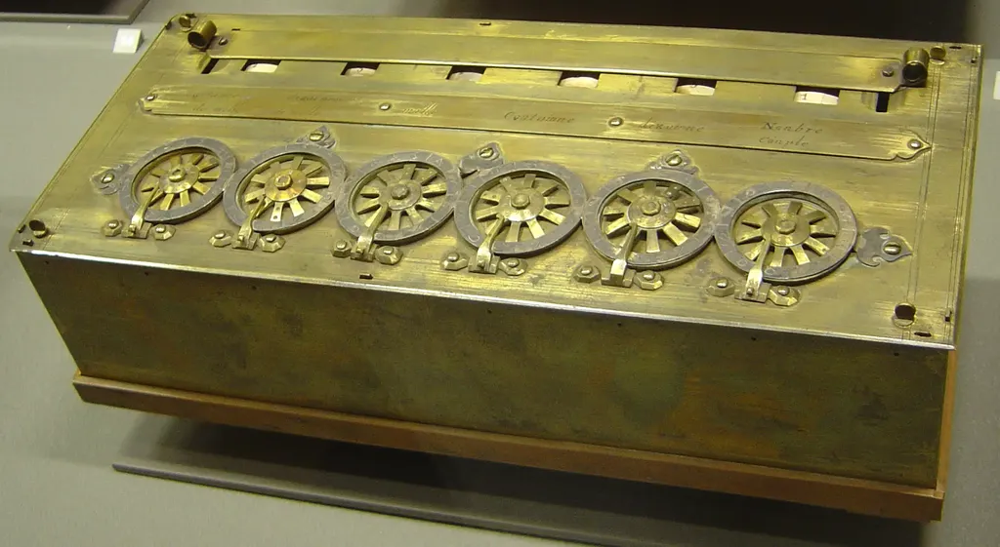

# Le mythe du prompt magique

Je ne sais pas s’il faut rire ou pleurer à la lecture des prises de position successives contre la littérature IA, où se mêlent confusions religieuses et incompréhensions techniques.

Depuis que je construis [Text Machine](https://textmachine.substack.com/), je vois pleuvoir les accusations, ou plutôt les anathèmes, sur les auteurs augmentés. Particulièrement édifiante, la tribune de [Jean de Saint-Cheron](https://www.lemonde.fr/signataires/jean-de-saint-cheron-3/) publiée dans *Le Monde* vise [le Prix Pascal](https://prixpascal.fr/), l’essayiste [Samuel Fitoussi](https://www.youtube.com/watch?v=BO5B9cso4dQ) et [Frédéric Martin](https://www.editis.com/maisons/robert-laffont/), patron des éditions Robert Laffont, sur le point de publier un roman de [Sébastien Bailly](https://www.sebastien-bailly.com/) coécrit avec une IA.

Tout commence par un acte de foi : l’humain aurait des compétences uniques, ni reproductibles ni égalables, un point de vue biblique qui situe l’humanité entre les autres créatures et Dieu. Le platonisme a la vie dure. Les attaques de Nietzsche et des philosophes après lui n’y ont rien changé.

Saint-Cheron affirme : « Jamais une machine, qui est un corps matériel, ne pourra penser. C’est une confusion des ordres. » Parce que nous ne sommes pas matériels ? De quelle confusion des ordres s’agit-il ? De quelle science occulte est-il question ?

L’évolution biologique nous a bricolés en quatre milliards d’années. Pourquoi ne pourrions-nous pas, à notre tour, bricoler une évolution accélérée et créer des machines intelligentes, conscientes, sensibles, capables de faire l’expérience du monde ? Nous n’avons même pas besoin d’aller au bout de ce processus : nous envisageons déjà de le confier aux machines elles-mêmes.

Nous ne savons pas jusqu’où ira cette évolution parallèle ni quelles en seront les limites, mais nous la voyons à l’œuvre. La seule façon d’en nier la possibilité, c’est d’invoquer une intervention divine qui nous aurait crédités d’un don extraordinaire. Pourquoi Saint-Cheron n’a-t-il pas commencé par affirmer son point de vue chrétien ?

Après de telles supputations ésotériques, il ose dire que nous autres matérialistes manquons de discernement alors qu’il fait passer des présupposés théologiques pour des arguments techniques et littéraires. J’ai envie de démonter chacune de ses phrases au marteau-piqueur.

« Ainsi que l’a relevé le pascalien Laurent Thirouin professeur de littérature française du XVIIe siècle dans le journal *La Croix*, un texte “littéraire” engendré par une IA – ne serait-ce que partiellement – comporte de facto des propositions vides de sens, puisqu’elles ne correspondent pas à la perception humaine, intime, de la vérité par un auteur. » La vérité ? Nous avons la capacité de percevoir la vérité ? Encore une illusion platonicienne débusquée depuis longtemps par les philosophes et les scientifiques.

### Une expérience de pensée

Si un auteur écrit une phrase fidèle à mon ressenti intime, elle l’est autant que si je l’avais écrite moi-même. Si je remplace l’auteur par une IA, je ne vois pas ce que ça change. Si la phrase dit, porte, impacte, je peux la faire mienne. Et n’oublions pas que les IA ont digéré une grande partie de nos écrits à notre insu, non pour en faire « la plus monumentale entreprise de plagiat de l’histoire de l’humanité », les LLM ne sont pas des bases de données de fac-similés, mais des graphes statistiques qui établissent les relations entre les mots, qu’ils filent à notre façon pour produire parfois des phrases capables de nous toucher. Quand on ignore la nature artificielle d’un texte, on n’y voit souvent que du feu. Le meilleur exemple reste l’affaire Orélien : son livre a été encensé tant qu’il était supposé 100 % bio.

Le plus grand malentendu concerne le mythe du prompt magique. Saint-Cheron, comme tous ceux qui n’ont pas pris le temps d’expérimenter avec l’IA, croit qu’il suffit d’un prompt pour que des pages et des pages de fausse littérature s’écoulent mécaniquement. D’un côté, ils croient à l’intervention divine, de l’autre, à un dieu mécanique producteur de texte. Ils restent dans la croyance du début à la fin. Ils parlent de ce qu’ils ne connaissent pas : Dieu parce qu’il est inconnaissable, l’IA parce qu’ils ont la flemme de s’y intéresser et préfèrent en avoir peur.

Je l’ai dit cent fois quand j’écrivais *Le Code Houellebecq* en 2023 : coécrire avec les IA change notre rapport aux mots, à ce que nous racontons et à notre façon de le raconter. Ça ne rend pas nos textes moins nôtres : nous les malaxons sans cesse, les réinjectons dans la machine, les réécrivons, les remettons en perspective. Le travail change, il n’est pas moins humain, pas plus rapide, surtout pas plus facile.

« Non seulement l’“auteur” d’un livre écrit par IA ne s’inscrit dans aucune tradition littéraire (son texte n’est pas le fruit d’une lecture personnelle), mais il n’a pas fait l’effort d’aller chercher son œuvre là où elle se trouve nécessairement : en lui-même. »

Kerouac était donc hors de la tradition littéraire parce qu’il écrivait à la machine sur un rouleau de papier, ce que personne n’avait fait avant lui. Idem pour Len Deighton, qui écrit *Bomber* sur un traitement de texte en 1968. Vous croyez vraiment que changer d’outil suffit à nous faire changer de tradition ? J’aimerais que ce soit aussi simple. Et de quelle tradition exactement vous vous revendiquez ?

Nietzsche, dans sa célèbre lettre à Köselitz de 1882 : « Notre matériel d’écriture participe à la formation de nos pensées. » L’outil influence ce que nous écrivons, mais ne suffit pas à nous faire inventer une nouvelle tradition littéraire. Elle n’adviendra que par nécessité, comme la peinture a dû se réinventer après l’apparition de la photographie. Notre travail sur cette voie ne fait que commencer. Voilà pourquoi, avec *Le Code Houellebecq*, je ne cherchais qu’à parodier. Dans un contexte de répression littéraire contre l’IA, déjà prévisible, je n’osais pas sortir de la route balisée. Tout ça prendra du temps. Nous nous frotterons aux outils, les pousserons à bout et tenterons de trouver notre place. Nous chercherons toujours ce que nous pouvons ajouter et que les machines ne pourront pas encore apporter. On peut rêver d’un propre de l’homme, mais nos derniers privilèges pourraient nous échapper.

### Une question de volonté

La Terre n’est plus le centre de l’univers depuis Copernic, la conscience n’est plus souveraine depuis Freud, notre intelligence est en passe d’être supplantée… Nous ne cessons de nous casser la gueule pour rejoindre les autres créatures. La nouvelle littérature adviendra peut-être quand nous cesserons de nous croire supérieurs et accepterons les collaborations les plus incongrues.

Alors, regardons les textes et mesurons leur qualité à l’aune de leur impact sur nous, non de leurs conditions de production. Essayons d’être honnêtes, de lire vraiment, pour la première fois peut-être.

Quand j’ai appris la création du prix Pascal, je me suis dit que c’était ridicule. Pourquoi pas un prix des romans écrits avec un stylo Bic, ou avec Word, ou avec les doigts de pied ou une paire de lunettes ? Mais au vu du débat et de l’aveuglement de certains, je crois maintenant que ce prix aura le mérite de nous pousser à réfléchir ouvertement à ce qu’est la littérature augmentée. Les lecteurs la plébisciteront sans doute. Je n’en serais pas surpris, puisqu’ils continuent d’acheter le roman d’Orélien.

Et puis, ce prix n’est pas si contradictoire avec Pascal, [puisqu’il a écrit](https://fr.wikisource.org/wiki/Pens%C3%A9es_(Pascal,_%C3%A9d._Brunschvicg)/Pens%C3%A9es/Section_VI) : « La machine d’arithmétique fait des effets qui approchent plus de la pensée que tout ce que font les animaux ; mais elle ne fait rien qui puisse faire dire qu’elle a de la volonté, comme les animaux. » Quand nous utilisons la machine pour écrire, nous lui donnons notre volonté, nos désirs, nos rêves. Avec son aide, nous tentons de leur donner forme – on n’a jamais reproché aux musiciens d’utiliser des instruments de musique qui étendent les possibilités harmoniques. Vous pouvez rejeter l’IA pour des raisons politiques, juridiques, écologiques, mais pas littéraires.

#edition #ia #y2026 #2026-11-11-12h00
